# Duo Desktop

*This README was written by Claude, an AI model, from the project's code and the owner's direction.*

Duo Desktop gives you precise control of **any computer** from an iPhone Duo: a Mac, a Windows PC, a Linux box, or even a computer with no working system at all.

It is precise because the controls are not on the picture. Open the phone. The top half of the big screen shows the computer's screen. The bottom half is a separate trackpad and keyboard, with a band of the computer's own keys. You move the pointer with the trackpad, the way you would on a laptop. Your finger never covers what it points at, so you can hit small buttons and pick out a few letters of text. To scroll, hold the **Scroll** button and move a finger on the trackpad.

**Zoom.** A whole computer screen on a phone is too small to read. **Follow Pointer** zooms in on the part around the pointer and moves with it, so text is full size and the pointer is always in view. Pinch in to see the whole screen, pinch out to zoom again.

**Ordinary iPhones.** Duo Desktop was built for the iPhone Duo. Some adaptation was done for ordinary iPhones: the same layout with a much smaller trackpad and fewer shortcut keys, a Mac's screen in Follow Pointer only, and the views in a drop-down. It was tried on an iPhone 16 Pro and an iPhone Air, but not extensively.

**Glass Act Host is what makes a Mac feel like it is in your hand.** Screen Sharing here does not use the Mac's built-in Screen Sharing. It uses [Glass Act](https://github.com/brianmario/glassact), an open-source project built from scratch for exactly this, and it is astonishingly good:

- **Text is pixel-perfect.** Glass Act is not a video stream. It sends the changed parts of the screen as exact pixels, so small text is as sharp on the phone as on the Mac.
- **Motion is smooth.** Scroll, drag a window or play a video and it switches to the Mac's hardware video encoder, then snaps back to exact pixels the moment things stop.
- **It keeps up.** It is built for low latency, so the pointer and your typing land right away.
- **A still screen costs nothing.** When nothing changes, nothing is sent.
- **A bad connection does not leave junk on screen.** When data is lost it sends what the screen shows now, not what it showed a moment ago.

Install the Host on a Mac once (see [Installing](#installing)) and that Mac is a different experience from any other way of reaching it.

**Use the Host from this repository, not Glass Act's own.** The two have the same name and look the same, but Duo Desktop needs the one on this repository's [Releases](https://github.com/Stratechery/duo-desktop/releases) page. It has changes the app depends on: several monitors, typing notices, unlock. With Glass Act's own Host you will have problems; for example, on a Mac with two displays the pointer can end up on the wrong one.

**More than one monitor.** A Mac with several monitors shows all of them. See every screen at once and tap the one you want, pick one by name, or just push the pointer past the edge of a screen and the picture follows it onto the next one. See [More than one screen](#more-than-one-screen-a-mac).

**Ways in.** One list of computers; each computer has one or more ways in:

| Way in | What it is | Works with | What that computer needs |
|---|---|---|---|
| **Screen Sharing** | The Mac's screen, fast and sharp, with control and copy and paste. Every monitor of a Mac with several | A Mac | **Glass Act Host**, a small free program (see [Installing](#installing)) |
| **Remote Desktop** | The PC's screen, through Windows' own Remote Desktop | A Windows PC | Remote Desktop turned on in Windows (Pro, Enterprise or Education). Nothing to install on the PC |
| **Terminal** | A command line | Anything with an SSH server: a Mac, Linux, a Windows PC (PowerShell) | An SSH server (on a Mac: Remote Login) |
| **JetKVM** | The screen, keyboard and mouse through a [JetKVM](https://jetkvm.com) box plugged into the computer's HDMI and USB | Any computer at all. It works before the system starts, in the BIOS, and when the system is stuck | A JetKVM box on your network |

**In the code:** Screen Sharing is always built. Remote Desktop, Terminal, JetKVM and iCloud list sync are each turned on by a **build switch** when you make the Xcode project (see [Building](#building)). A plain build has none of their code. The ready-made test build the owner uses has all four switched on.

**How you hold the phone:**

- **Open and upright:** the picture on top, the trackpad and keyboard below. For real work.
- **Open and sideways:** a wide picture, with the trackpad and a column of buttons at the sides.
- **Folded, on the outside screen:** made for **answering a computer's system dialog boxes**: a permission prompt, a password box, an "Allow / Don't Allow". Answer it quickly without opening the phone. It is not for working on the computer. See [The outside screen](#the-outside-screen).

> ## Free. No support. No guarantees.
>
> - Duo Desktop is **free** to download and use, under the [MIT licence](LICENSE).
> - It was built for **one person's own setup**. It is shared as it is.
> - There is **no support of any kind.** Issues and questions may go unanswered. Nothing will be fixed or added on request.
> - There is **no guarantee** that it works, that it keeps working, or that it is safe for any purpose.
> - **You use it at your own risk.** It controls real computers: it clicks, types and can type passwords. It can take over a computer's session: signing in with Remote Desktop disconnects whoever is using that PC.
> - The licence says it in its own words: *"THE SOFTWARE IS PROVIDED "AS IS", WITHOUT WARRANTY OF ANY KIND, EXPRESS OR IMPLIED, INCLUDING BUT NOT LIMITED TO THE WARRANTIES OF MERCHANTABILITY, FITNESS FOR A PARTICULAR PURPOSE AND NONINFRINGEMENT."* Read the whole [LICENSE](LICENSE).

The code here is **build 0.1 (89)**. Read [Known issues](#known-issues) before you start.

*Pictures on this page are the real app in the iPhone Duo Simulator. The computers in them are test stand-ins under made-up names; no real computer is shown. Some pictures are from older builds; where the app has changed, the text says what is different.*

Contents:

1. [Your computers](#your-computers)
2. [Screen Sharing (a Mac)](#screen-sharing-a-mac)
3. [Remote Desktop (a Windows PC)](#remote-desktop-a-windows-pc)
4. [Terminal (Mac, Linux, PC)](#terminal-mac-linux-pc)
5. [JetKVM (any computer)](#jetkvm-any-computer)
6. [Holding the phone: upright, sideways, folded](#holding-the-phone-upright-sideways-folded)
7. [The outside screen](#the-outside-screen)
8. [More than one screen (a Mac)](#more-than-one-screen-a-mac)
9. [Keyboard, key band and gestures](#keyboard-key-band-and-gestures)
10. [Security](#security)
11. [Installing](#installing)
12. [Building](#building)
13. [Make it yours](#make-it-yours)
14. [Tested on a real phone](#tested-on-a-real-phone)
15. [Known issues](#known-issues)
16. [Licence, third-party notices and trademarks](#licence-third-party-notices-and-trademarks)

---

## Your computers

| |
|---|
| 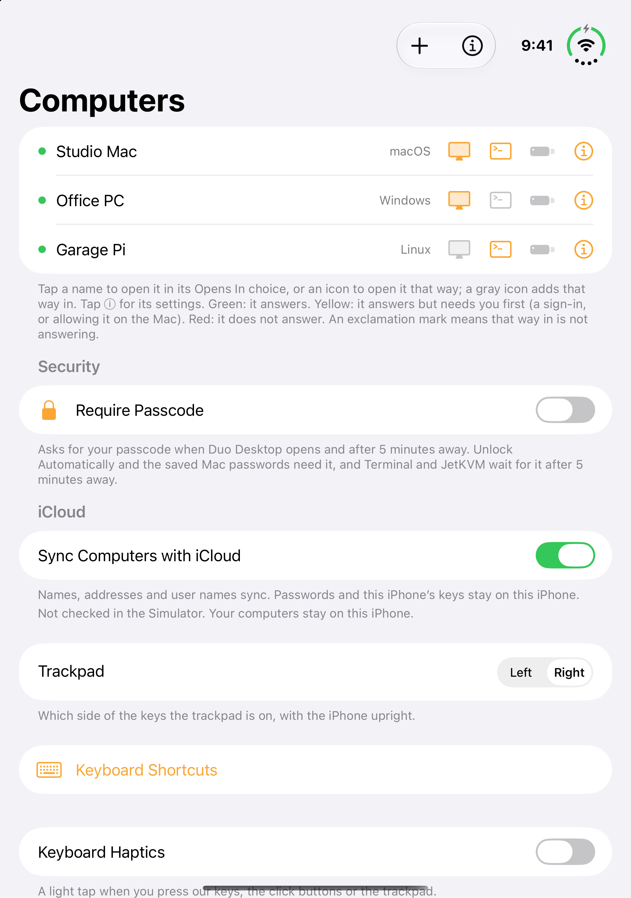 |
| **The Computers list.** Each computer on one line: its light, its name, its system as a gray word, the three ways in and ⓘ. |

**The list.** One line per computer:

- A **light** at the start: green, ready; yellow, it answers but needs something from you (a sign-in or an approval); red, not answering; gray, still being checked.
- The computer's **name**. Tap it to open the computer its usual way (**Opens In**, chosen on its ⓘ page).
- Its **system** as a gray word: **macOS**, **Windows** or **Linux**.
- Three **way-in icons**, the same on every row: **Screen Sharing** (or Remote Desktop, for a PC), **Terminal** and **JetKVM** (a small HDMI stick). Tap an icon to open the computer that way. A gray icon is a way in that is not set up yet; tapping it adds it. A red badge means that way is set up but not answering.
- **ⓘ**: the computer's settings.

Below the computers: **Security** (the app lock), **iCloud** (list sync, in builds that have it), **Trackpad** (left or right), **Keyboard Shortcuts**, **Keyboard Haptics**, and last **This iPhone** (this phone's key).

**Adding a computer.** Tap **＋**. One **Add Computer** sheet for every kind: type a name, choose **Start With** (Screen Sharing, Remote Desktop, Terminal or JetKVM) and fill in what that way needs. The sheet checks the computer and tells you what is wrong and what to do if the check fails; you can fix the fields and **Try Again**. Add more ways in later from the computer's ⓘ page ("Add Screen Sharing…", "Add Remote Desktop…", and so on).

A computer has **Screen Sharing or Remote Desktop, not both**: a Mac uses Screen Sharing, a PC uses Remote Desktop. Terminal and JetKVM can be added to either.

**List sync through iCloud** (builds with the sync switch). The list can sync between your iPhones that use the same Apple Account. It is on by default and can be turned off in the list. Only the list syncs: names, addresses, which ways in each computer has, and their settings. **Passwords, keys and trusted certificates never leave the iPhone.** If the same computer was changed on two iPhones, the newest change wins. Removing a computer asks whether to remove it from **All Devices** or **This iPhone Only**. Under the iCloud switch the app shows when this iPhone last sent and last checked for changes, how many computers are waiting to be sent, and why iCloud refused a computer; a refused computer goes again each time you open Duo Desktop.

---

## Screen Sharing (a Mac)

**What you see.** The Mac's screen, with its own pointer. Two views, chosen from the top bar:

| | |
|---|---|
|  | **Whole Screen.** The whole Mac screen fits the phone. Good for seeing where things are. Small text is small. |

**Follow Pointer** is the zoomed-in view. A whole Mac screen on a phone is too small to read, so this shows only the part around the pointer, at a readable size. **The pointer stays put, and the Mac moves under it.** When you move the pointer, the picture slides instead, so the spot you are working on stays in the middle. Near an edge of the Mac's screen the picture stops and the pointer moves off centre, so you never see empty space past the edge.

| | | |
|---|---|---|
|  |  |  |
| **1.** Zoomed in on the text under the pointer. | **2.** The pointer moved down. The picture moved with it; the pointer is still in the middle. | **3.** Near the left edge the picture stops, and the pointer moves off centre. |

**Pinch to change view.** One step per pinch: Follow Pointer → (pinch in) → Whole Screen → (pinch in) → All Screens (only on a Mac with more than one screen). Pinch out to go back. A pinch never moves anything on the Mac.

**The top bar.** A back arrow on the left. In the middle, the computer's name, with a second line under it that says what you are looking at (the screen's name, "All Screens", "Terminal" or "JetKVM"). Tap the name for a menu of the Mac's screens. On the right, the view choices: on the open Duo, all of them side by side when they fit; on a normal iPhone, or when they do not fit, one button with a drop-down.

| |
|---|
| 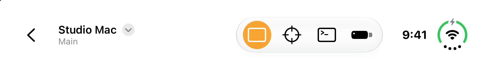 |
| **On the open Duo.** The name over the screen's name, and the four views side by side. |

| |
|---|
| 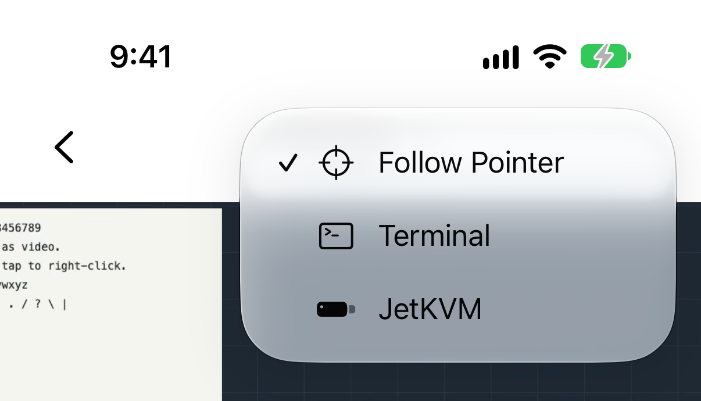 |
| **On a normal iPhone.** One button; its drop-down lists the other views. |

**Why it is fast.** It runs on Glass Act Host; see [the top of this page](#duo-desktop).

**What the Mac needs.** Glass Act Host from this repository's [Releases](https://github.com/Stratechery/duo-desktop/releases) (not Glass Act's own), running, with its two permissions (Screen Recording, Accessibility); see [Installing](#installing). The first time, you sign in once with the Mac's user name and password, or approve the phone at the Mac.

**Unlock Automatically.** In a Mac's ⓘ page. When the Mac's screen is locked, Duo Desktop types its password for you. The password stays in this iPhone's Keychain. It needs the app lock (see [Security](#security)): one Face ID or Touch ID then unlocks every Mac. When the lock is off, a **Turn On** button sits right under the switch.

| |
|---|
| 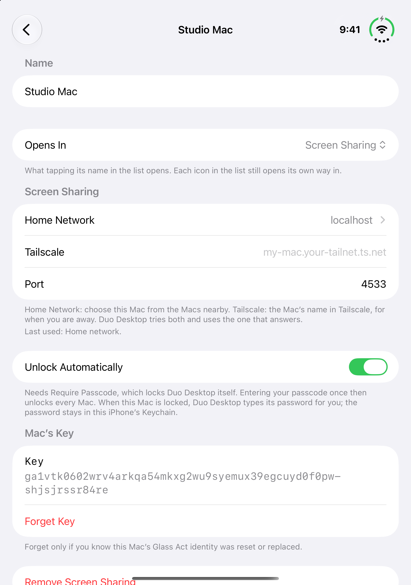 |
| **A Mac's ⓘ page, top.** Name, Opens In, the addresses and Unlock Automatically. Terminal and JetKVM are further down. |

**Home Network.** In a Mac's ⓘ page: tap it to pick the Mac from those nearby, or type an address.

**Limits.** Macs only. The Mac needs the Host running and its permissions granted.

---

## Remote Desktop (a Windows PC)

**What you see.** The PC's screen, through Windows' own Remote Desktop. The same trackpad, button column and keyboard as for a Mac, in the same places, with **Windows keys** on the key band (see [Keyboard](#keyboard-key-band-and-gestures)). Whole Screen and Follow Pointer work as for a Mac; so does holding the phone sideways.

By default the app asks Windows for a 1920 × 1080 screen with text at 200%, so things are big enough to hit on a phone. **Size** and **Text Size** (200% or 150%) are on the PC's ⓘ page.

| |
|---|
| 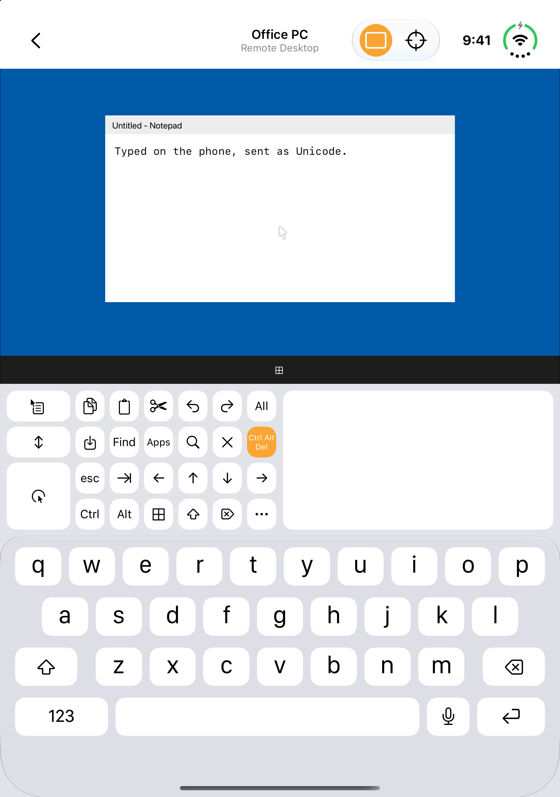 |
| **Remote Desktop.** The PC's screen on top; the Windows keys and the trackpad below. |

**Signing in.**

- Before it connects, the app warns you: **anyone using the PC now is disconnected while you are connected.** Their apps stay open, and they get them back when they sign in at the PC. You can choose **Don't Ask Again for This PC**.
- The first time, the app shows the PC's certificate fingerprint and asks whether to trust it. If a different certificate answers later, the app refuses to connect. If you reinstalled Windows or renamed the PC, use **Forget Certificate** on its ⓘ page and connect again.
- **Remember Password** keeps the password in this iPhone's Keychain, behind the app lock, so a remembered PC connects with no typing. It is saved only after Windows accepts it, and deleted when you remove the PC or turn the lock off.
- If you leave the app and come back, it reconnects without asking again.

**What the PC needs.** Windows Pro, Enterprise or Education (Windows Home cannot accept Remote Desktop), with Remote Desktop turned on, reachable on port 3389. Nothing to install on the PC.

**Limits.** No touching the picture to click (use the trackpad). The pointer does not change shape the way Windows draws it. The outside (folded) screen does not show a PC.

---

## Terminal (Mac, Linux, PC)

| | |
|---|---|
|  | **Terminal.** A command line on the computer over SSH, with a row of terminal keys (esc, tab, Control, arrows and more). |

**What the computer needs.** An SSH server. On a Mac: Remote Login, turned on in System Settings. On Linux: the usual SSH server. On a Windows PC: Windows' own OpenSSH Server.

**Signing in.** With this iPhone's own key (never a stored password).

- **A Mac with Glass Act Host:** the Host adds the phone's key for you.
- **A Mac or Linux computer without the Host:** the Add sheet adds the key itself, with one password sign-in. The password is used once and not kept.
- **A Windows PC:** you add the phone's key to the PC yourself for now (see [Known issues](#known-issues)). The phone's key is under **This iPhone** in the list.

**tmux, on a Mac or Linux.** Choose tmux to come back to the same session after the link drops or the phone sleeps.

**A Windows PC.** The app knows a PC by its SSH server's greeting (or because the computer has Remote Desktop). For a PC it shows only what applies: it signs in with this iPhone's key, and it opens PowerShell or Command Prompt, as the PC is set. There is no tmux on a PC: when the link drops, the app reconnects to a fresh prompt.

| |
|---|
| 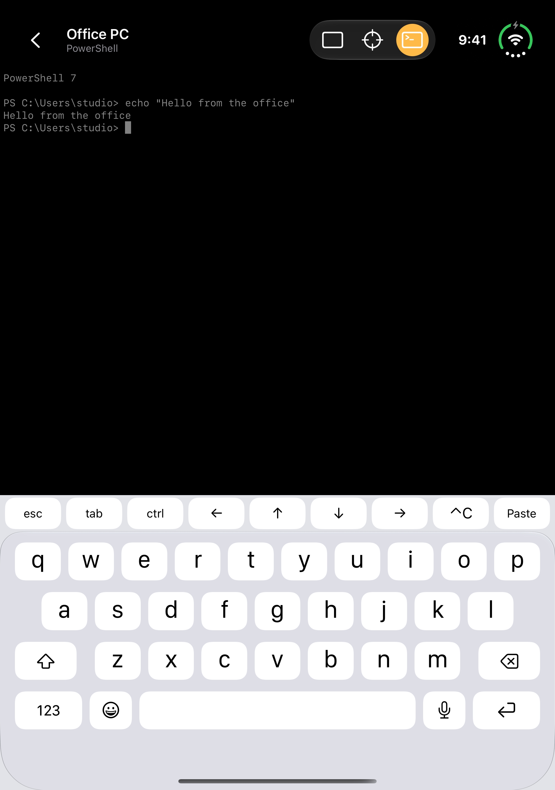 |
| **Terminal on a PC.** The second line says PowerShell. |

If a sign-in fails, the screen says what is wrong (for example a wrong user name) and what to do, with a way to the computer's settings or to another way in.

---

## JetKVM (any computer)

| | |
|---|---|
|  | **JetKVM.** The computer's screen through a [JetKVM](https://jetkvm.com) box plugged into its HDMI and USB. It works while the computer starts up, in its BIOS, while it sleeps or when it is stuck: any time the screen shows something. Shown here while it connects. |

**What the computer needs.** Nothing at all on the computer. A JetKVM box plugged into it, on your network, with its password.

**How it behaves.**

- When it starts, it says which step it is on: **Signing in…**, **Starting the session…**, **Waiting for the picture…**.
- If the video does not arrive within 12 seconds, it tries again by itself, up to 3 attempts (**Trying again (2 of 3)…**), then shows the reason and **Try Again**. A wrong password or an unreachable address is shown at once. What happened is in that computer's **JetKVM Log**.
- If the computer's display is asleep, the app presses Left Shift to wake it and says **Waking the display…**.
- Keys go to the computer as a real USB keyboard would send them, capitals and symbols included.
- Turning the phone keeps the session: it does not reconnect.

**Limits.** The connection is sometimes unreliable (see [Known issues](#known-issues)). The JetKVM's own login is plain `http://`: reach it only over your home network or Tailscale.

---

## Holding the phone: upright, sideways, folded

**Open and upright.** The computer's picture on top. Below it: the trackpad, the key band and the keyboard.

**The trackpad can be on the right or the left.** In the list: **Trackpad**, **Left** or **Right** (right is the default). The keys keep their order either way; only the trackpad and the button column swap sides.

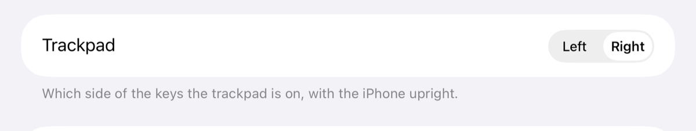

**Open and sideways.** A wide picture of the whole screen. The trackpad sits at one side, and a column of buttons at the other: **Keyboard**, **Right click**, **Scroll** and **Click**.

| |
|---|
| 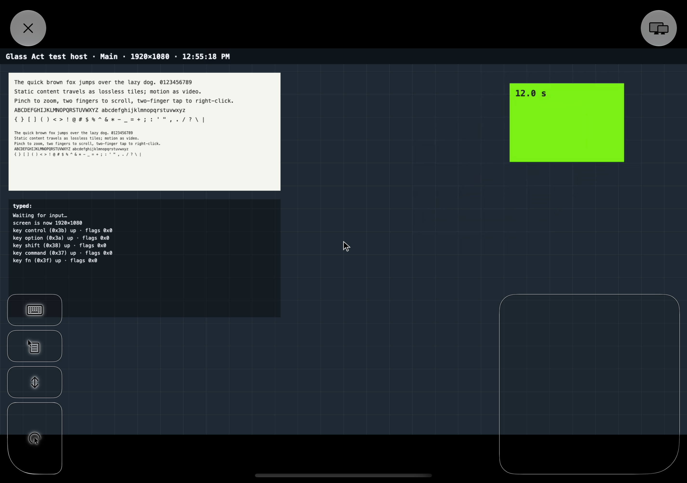 |
| **Sideways.** The whole screen, with the button column on the left and the trackpad at the bottom right. |
|  |
| **Typing sideways.** Duo Desktop's own keyboard, with the computer's keys along the top (esc, tab, Control, Option, Command, Shift, arrows on a Mac). Keys show a pop-up of the letter as you press them. Here the G key is held. |

**Folded.** The outside screen, for answering dialog boxes; next section.

---

## The outside screen

**The outside (folded) screen is designed for answering a computer's system dialog boxes**: a permission prompt, a password box, an "Allow / Don't Allow". You answer it quickly without opening the phone. It is **not** for working on the computer: for anything more, open the phone.

What it has for that:

- **It opens where dialogs appear.** The picture is shown at full size (one screen pixel per phone point), placed where macOS puts its dialogs, near the top middle of the screen.
- **If the Mac is locked** and its password has to be typed here, it opens on the password box with the keyboard already up.
- **One finger taps** to click (two quick taps double-click).
- **Two views,** in a small strip of buttons under the clock: **up and down** (one finger moves the picture up and down; the default) or **any direction** (two fingers move the picture; one finger taps or drags on the computer). Choosing up-and-down brings the picture back to the dialog spot.
- **Keyboard**: the iPhone's keyboard, for a password or a short answer.
- **Macs**: back to the list.

| |
|---|
| 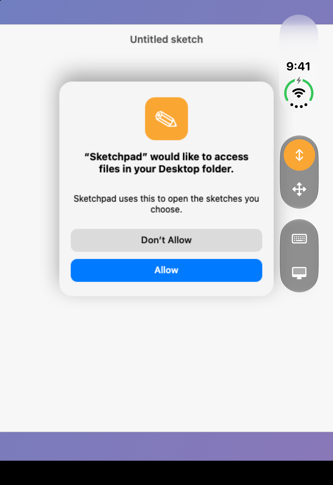 |
| **A dialog on the outside screen.** The buttons sit in the strip under the clock. |

| |
|---|
| 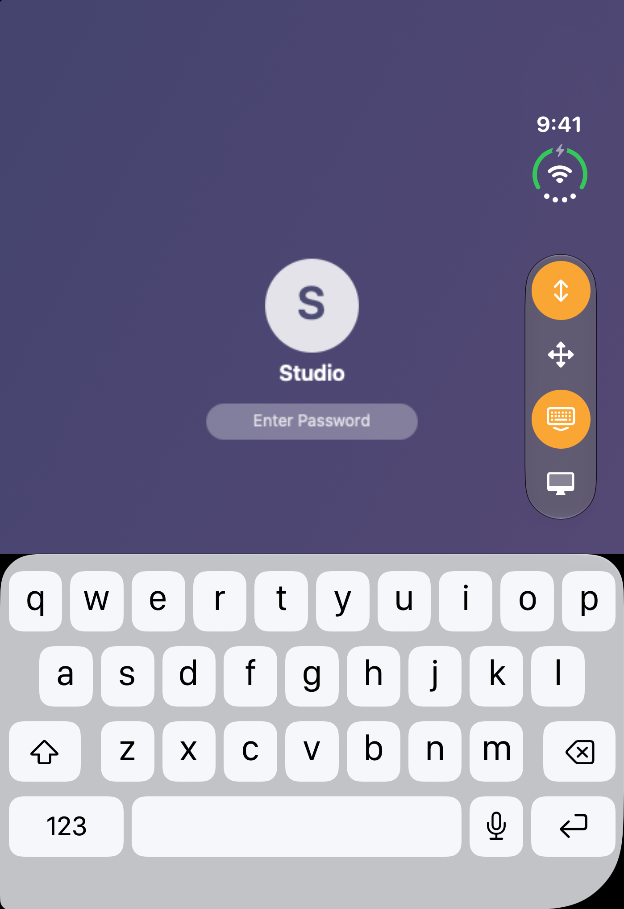 |
| **A locked Mac.** The password box sits above the iPhone keyboard. |

| |
|---|
|  |
| **The list, compact.** |

The outside screen shows a Mac's Screen Sharing. Remote Desktop, Terminal and JetKVM are for the open phone.

---

## More than one screen (a Mac)

A Mac with several screens shows them all. The second line under the name in the top bar always says which screen you are on.

| | |
|---|---|
| 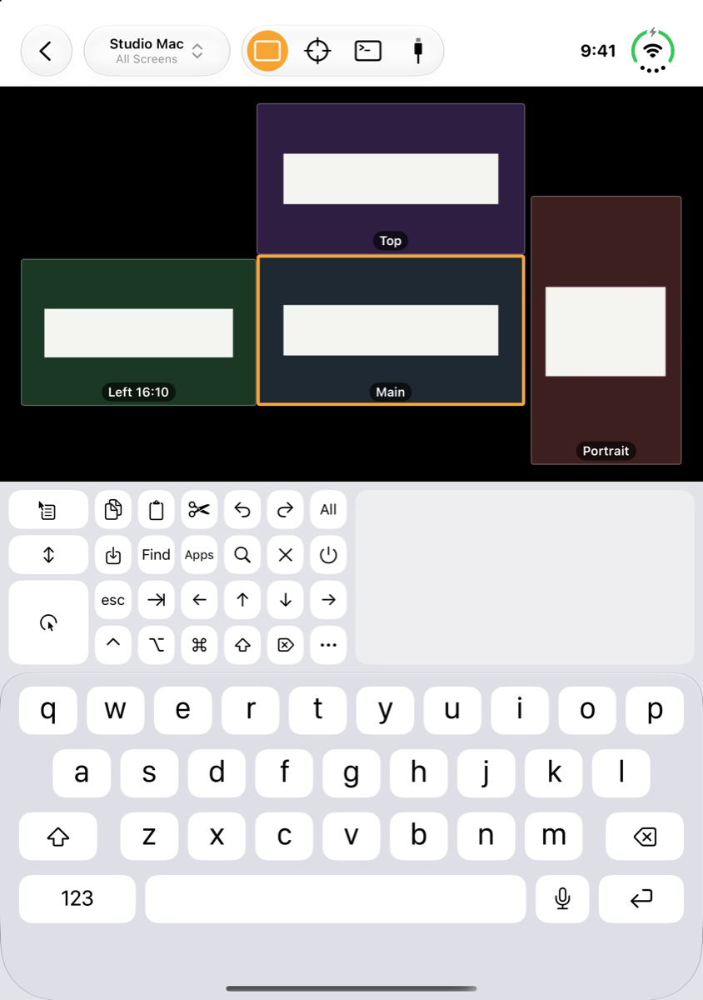 | **All Screens.** Every screen of the Mac as a live snapshot, laid out as on the desk. The one you are on is outlined. Tap a screen to go to it. Pinch in from Whole Screen to get here. |
| 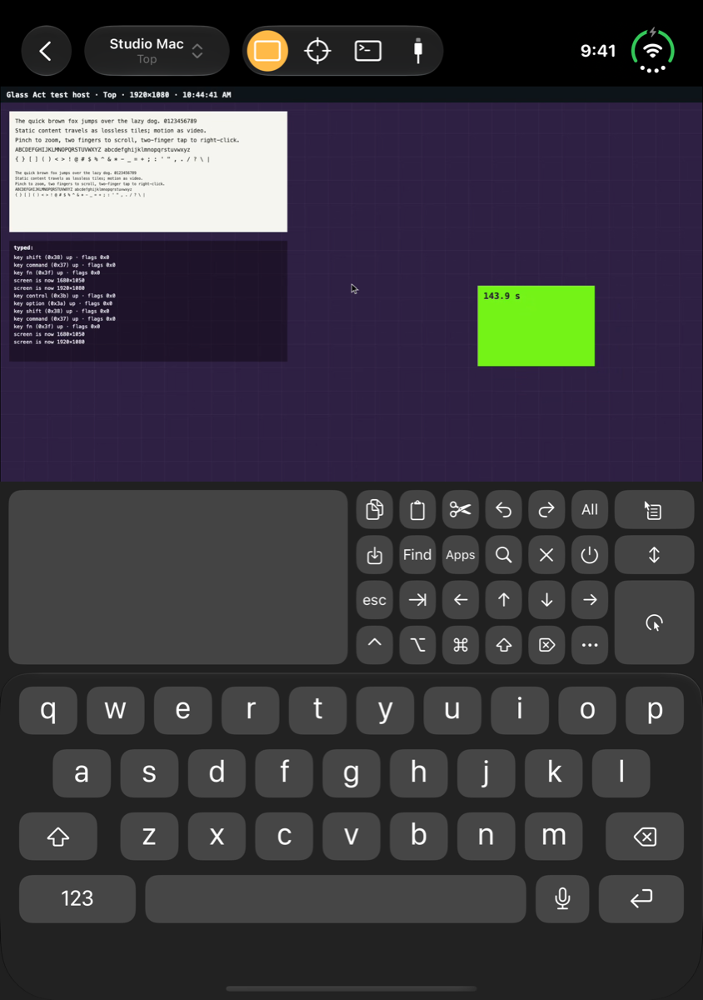 | **Picking a screen.** Tap the name in the top bar. A menu lists the Mac's screens; choose one. Here the screen called "Top" is shown. The app remembers the last screen for each Mac. |
| 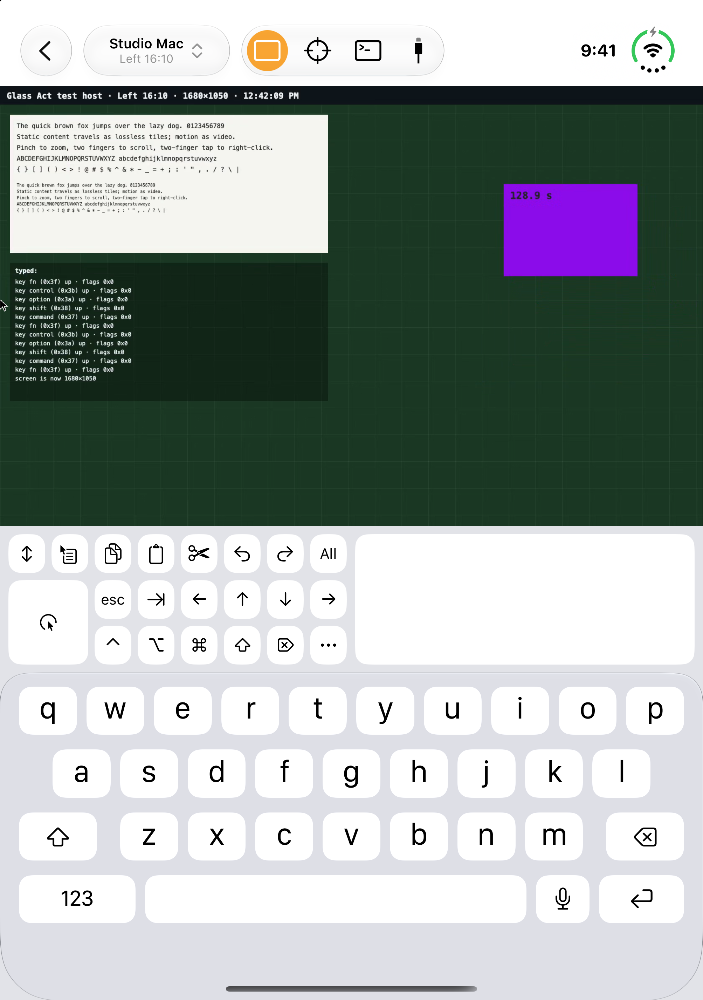 | **Crossing a screen edge.** Push the pointer past the edge of a screen. If another screen sits on that side, the picture slides over to it, as at the Mac. The pointer carries on from the same height. |

---

## Keyboard, key band and gestures

**The key band** sits between the picture and the keyboard. It shows the keys of the computer you are on.

| | |
|---|---|
| 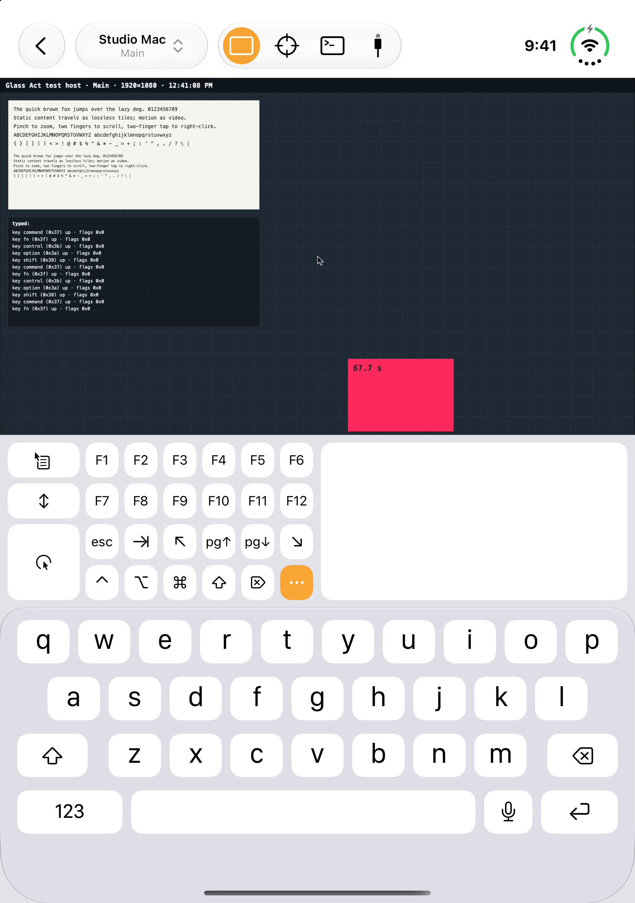 | **On a Mac.** Command, Option, Control, Shift, arrows, Copy, Paste, the app switcher and more. **··· (More)** swaps in F1–F12, Home, End, Page Up and Page Down. |

**On a Windows PC** (Remote Desktop) the keys read **Ctrl**, **Alt** and **⊞** (the Windows key), and the band sends Windows shortcuts: Copy is Ctrl+C, Paste is Ctrl+V, and so on; the app switcher is Alt+Tab held; Search is ⊞+S; Close is Alt+F4. **Ctrl Alt Del** sits where the power key sits on a Mac. It can be sent two ways: Ctrl Alt Delete, or Ctrl Alt End (the keys Windows' own Remote Desktop app uses for it). A tap sends the one you used last; touch and hold to pick the other. **··· (More)** adds Print Screen and Task View.

| |
|---|
| 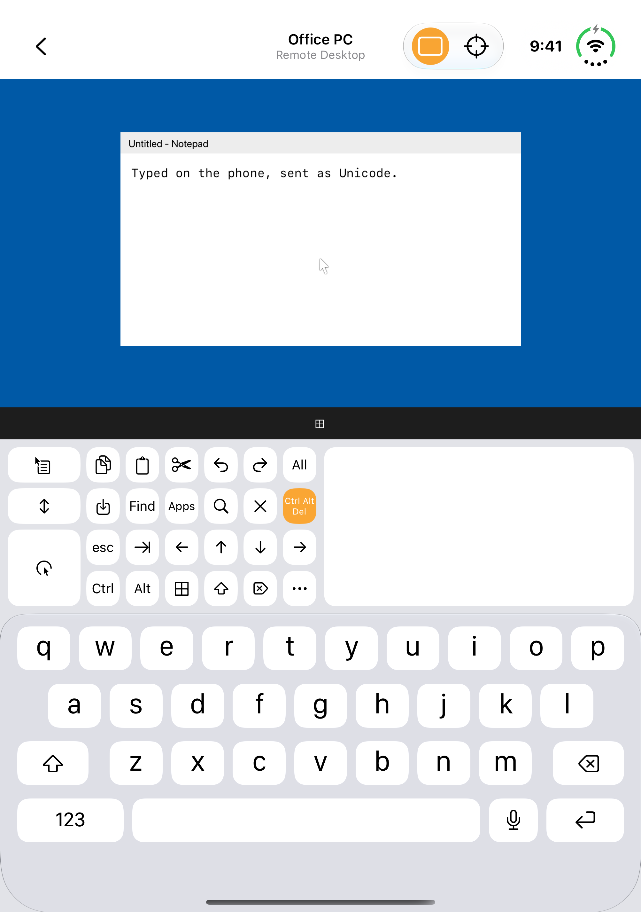 |
| **The Windows key band.** Ctrl, Alt and ⊞ in the bottom row; the orange key is Ctrl Alt Del. Touch and hold it to pick Ctrl Alt Delete or Ctrl Alt End. |

**Typing.** Tap **Keyboard** for a keyboard; what you type goes to the computer. On the open Duo it is the iPhone's own keyboard; held sideways, it is Duo Desktop's own.

**Keyboard Shortcuts.** A sheet listing every button and key and what it does. Open it from the list.

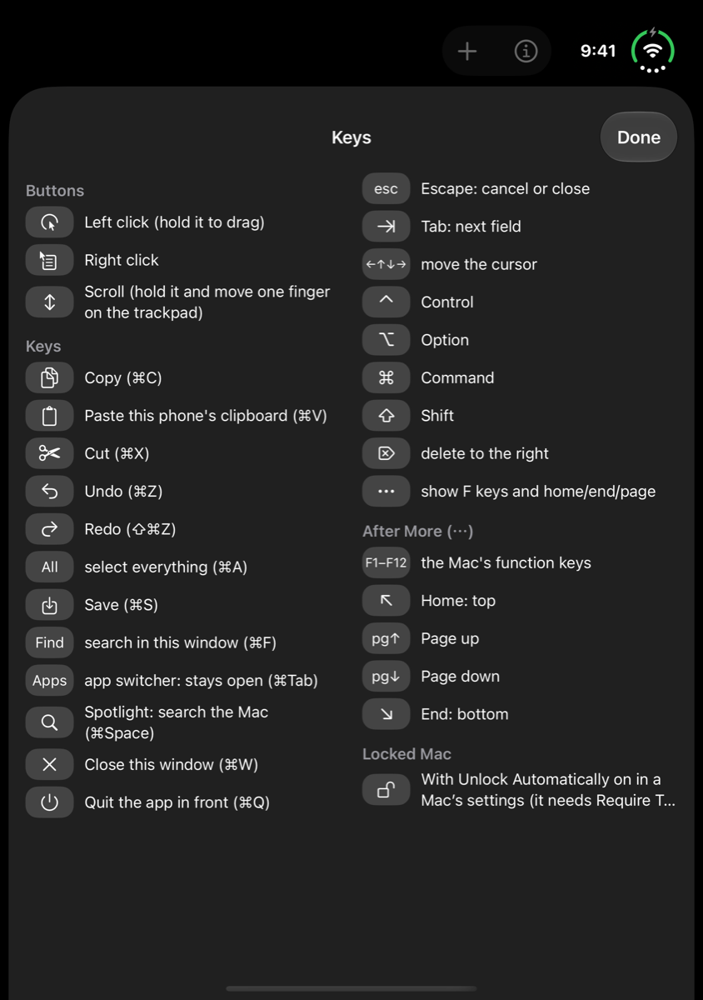

**Gestures on the trackpad.** One finger moves the pointer. A tap clicks; a two-finger tap right-clicks. Two fingers scroll. Tap, then touch and hold, then move, to drag. The **Click**, **Right click** and **Scroll** buttons in the button column do the same; hold **Click** while you move a finger on the trackpad to drag.

**Gestures on the picture (a Mac's Screen Sharing).** A tap clicks where you touch. Touch and hold, then lift, right-clicks. One finger dragged scrolls. Three-finger swipes are Mission Control, App Exposé and Spaces. A swipe in from the top or bottom edge shows a hidden menu bar or Dock. Pinch changes the view.

---

## Security

- **Where secrets live.** Mac passwords (for Unlock Automatically), PC passwords (Remember Password), JetKVM passwords and this iPhone's own key are kept in this iPhone's Keychain, **on this device only**. On a signed phone build the key is in the Secure Enclave.
- **What syncs and what never does.** With iCloud sync on, only the list syncs (names, addresses, ways in and their settings), in encrypted fields in your own private iCloud database. Passwords, keys and trusted certificates **never** sync.
- **The app lock.** **Require Face ID** (Touch ID on the iPhone Duo) locks Duo Desktop itself. It is in the **Security** section of the list, on by default, and asks when the app opens and after 5 minutes away. While locked, nothing connects and no password is read. Turning it off while Macs use Unlock Automatically warns first and names those Macs; their saved passwords are then deleted from the phone.
- **Glass Act Host (a Mac).** It trusts only phones approved on that Mac, by the Mac's user name and password once or by you at the Mac. Each approved phone is known by its own key. Anyone else is refused before they see anything. The connection is encrypted end to end (QUIC with TLS 1.3); there is no unencrypted mode. See Glass Act's [security notes](https://github.com/brianmario/glassact#security).
- **An approved phone can do what the person at the Mac can do:** see the screen, move the pointer, click and type, copy and paste, type the Mac's password into its lock screen (with Unlock Automatically) and, for the Terminal, add the phone's SSH key to that user's account. Treat approving a phone like handing over your keyboard. Set a phone to **View Only** in the Host's **Viewers** menu to allow watching only.
- **Keys are pinned.** The phone remembers each Mac's Host key, and each PC's certificate, on first contact. If a different one answers at the same address, the app refuses to connect.
- **Remote Desktop takes over the PC's session.** Whoever is using the PC is disconnected while you are connected.
- **Network.** Use it on your own network or Tailscale. Do not open these computers' ports to the internet.
- **Outside review.** The Mac, Terminal and JetKVM code had two rounds of outside code review. Remote Desktop, the PC Terminal and list sync have not had an outside code review.

---

## Installing

**Free, no support, no guarantees: you install and use this at your own risk.**

- **The iPhone app** is built by you from this code with Xcode (see [Building](#building)).
- **Glass Act Host** (for Screen Sharing on a Mac): a ready-to-install Host is attached to this repository's [Releases](https://github.com/Stratechery/duo-desktop/releases). It is signed with Developer ID and notarized by Apple. Use this one: Glass Act's own Host has the same name but lacks the changes the app depends on, and you will have problems with it. The current one, "Glass Act Host 26.11.3 for Duo Desktop 48", still works with today's app: the messages between them are the same. The app itself is built against Glass Act v26.11.4. You can also build the Host yourself; that build is v26.11.4 with the same patches.
- **Windows PC:** nothing to install for Remote Desktop; turn Remote Desktop on in Windows. For Terminal, turn on Windows' OpenSSH Server.
- **Linux:** an SSH server for Terminal.
- **JetKVM:** set up the box as its maker describes.

The full, step-by-step guide is in **[docs/INSTALL.md](docs/INSTALL.md)**:

- [What you need](docs/INSTALL.md#what-you-need): an iPhone Duo on iOS 27, a Mac with Xcode 27.2, Macs on macOS 15.5 or later, an Apple developer account.
- [Install the Host on a Mac](docs/INSTALL.md#install-the-host-on-a-mac).
- [First connection](docs/INSTALL.md#first-connection).
- [Settings for each Mac](docs/INSTALL.md#settings-for-each-mac).

*The install guide is still written for Macs; it does not yet cover a PC or Linux.*

---

## Building

One code base, several versions. You choose when you make the Xcode project, by putting switches before `xcodegen generate`:

| You want | Add |
|---|---|
| **Plain** (Screen Sharing for Macs only) | nothing: `xcodegen generate` |
| **Terminal** | `DUO_TERMINAL=YES` |
| **JetKVM** | `DUO_JETKVM=YES` |
| **Remote Desktop** (Windows PCs) | `DUO_RDP=YES` |
| **List sync through iCloud** | `DUO_SYNC=YES` |

Switches combine. Everything at once: `DUO_TERMINAL=YES DUO_JETKVM=YES DUO_RDP=YES DUO_SYNC=YES xcodegen generate`.

- **Remote Desktop** builds FreeRDP and OpenSSL from pinned versions (`app/scripts/build-freerdp.sh`); this needs CMake on the Mac.
- **List sync** uses the iCloud container `iCloud.<your bundle id>`. Your App ID needs iCloud (CloudKit) with that container, and the container needs a record type `Computer` with four fields of type **Encrypted Bytes**: `payload`, `remoteDesktop`, `terminalSystem` and `unameSystem`, deployed to Production in the CloudKit Console. Until then the app says iCloud is not ready and keeps the list on the phone. If one of the four fields is missing, every save fails without a message until that field is added.
- One more switch, `DUO_VNC` (Basic Screen Sharing for Macs without the Host), is **not finished**. It compiles; do not use it.

`app/scripts/test.sh --switches-only` compiles the plain version and one version per switch; without `--switches-only` it then runs the unit tests. It fails if any version does not compile.

The steps (Glass Act for the app, your bundle id and team, the Simulator, your phone) are in [Build the iPhone app](docs/INSTALL.md#build-the-iphone-app).

---

## Make it yours

This whole project was vibe coded: an AI coding agent wrote every line, directed by one person describing what he wanted and trying it on his phone. So the way to make it yours is the way it was made. It was built for one setup, yours is different, and nobody here will change the app for you. Hand the code to a coding agent (Claude Code, Codex or similar) and let it walk you through. You do not need to know how to build an iPhone app, or even to have downloaded the code. Paste this:

```text
This is Duo Desktop: an iPhone app that controls computers through Screen Sharing (Glass Act Host on a Mac),
Remote Desktop (Windows), Terminal (SSH) and JetKVM. Its code is at https://github.com/Stratechery/duo-desktop
I want to build it and adapt it for my own use. If you do not have the code yet, get it from that address first
and tell me where you put it.

Assume I know nothing about building iPhone apps. Walk me through everything, one step at a time. Ask me one
question at a time, wait for my answer, and never assume I already have something set up. When a step needs me to
click or type somewhere, tell me exactly where and what, and wait until I say it is done.

Read README.md and docs/INSTALL.md first. The app is in app/. It has one code base and build switches
(DUO_TERMINAL, DUO_JETKVM, DUO_RDP, DUO_SYNC), explained under "Building" in the README.

Start by finding out what I have, and help me get whatever is missing:
- A Mac that can run Xcode, and Xcode installed. Check for me and tell me how to install it if it is not there.
- An Apple Account signed in to Xcode. Explain the difference between a free account and the paid Apple Developer
  Program for what I want (running the app on my own phone, how long it keeps working, iCloud sync), and what
  each costs, from Apple's own pages. Do not guess.
- My developer team. Find it yourself from Xcode or the Mac if you can; if you cannot, show me where to look.
- A bundle id. Explain in one sentence what it is and suggest one for me.
- My phone: which iPhone it is (a Duo or a normal iPhone), and how to get it ready to run an app from Xcode.
- My computers: for each one, whether it is a Mac, a Windows PC or Linux, and how my phone reaches it (home
  network, Tailscale, a JetKVM). Then tell me which ways in fit each computer and which build switches that means.

Then:
1. Build the app unchanged for the iPhone Simulator, so we know it works as it comes. Show it to me.
2. Help me put it on my real phone, and set up each of my computers (for a Mac that means installing Glass Act
   Host; walk me through that too).
3. Only then ask what I want changed. Make one change at a time. After each one, run app/scripts/test.sh and
   show me the result before going on.

Rules for the whole job:
- Do not weaken what protects my computers: the app lock, where passwords and the phone's key are kept, the
  certificate and host-key checks. If a change touches those, stop and explain it to me first.
- Keep my own details (computer names, addresses, user names, team id) out of anything I might publish.
- When something cannot be tested in the Simulator and needs my real phone or a real computer, say so and tell me
  exactly what to try.
- If you are not sure about something Apple, Microsoft or Tailscale requires, look it up on their own pages and
  tell me where you read it.
```

The same rule applies to whatever the agent builds for you: no support, no guarantees.

---

## Tested on a real phone

The owner tested on a real iPhone Duo and reported:

- **Unlock Automatically** works (2026-11-21, builds 45 to 47).
- The **Terminal** view works (2026-11-21).
- The **JetKVM** view works (2026-11-21).
- **Keyboard sounds and haptics** work (2026-11-21).
- **Remote Desktop** to a real Windows PC works (2026-11-24).
- **Terminal on a Windows PC** (PowerShell) works (2026-11-24).
- **List sync** between two iPhones works (2026-11-24).

On a normal iPhone it was tried on an **iPhone 16 Pro** and an **iPhone Air**, but not extensively.

Nothing else is claimed here. Everything else was tested in the Simulator, against Glass Act's test host, or not at all.

---

## Known issues

**Free, no support, no guarantees.** Nothing below will necessarily be fixed.

- **Built for one setup.** Tuned for the iPhone Duo and for screens that look about 1920 points wide. Other sizes work but were not tuned.
- **Terminal on a Windows PC:** the app does not add this iPhone's key to a PC yet; you add it yourself. The top bar always says "PowerShell", even when the PC is set to open Command Prompt (Windows' own default).
- **Scrolling through JetKVM** is sent as a mouse wheel turned the way a Mac with natural scrolling (the Mac's default) needs, so the page follows your fingers. On a PC, a Linux computer, or a Mac with natural scrolling off, the direction comes out reversed. This was measured on a Mac only.
- **The JetKVM connection is sometimes unreliable.** Sometimes the video connection does not form ("ICE failed"). The JetKVM's own web page in a browser has the same problem. A likely cause on the app's side was fixed (the app now always sends its connection offer before its network addresses, which firmware 0.5.10 needs); that fix is likely, not proven. Meanwhile the app retries by itself, and the **JetKVM Log** shows what happened.
- **The outside screen's buttons** follow the system area at the top and keep clear of the camera; this was checked in the Simulator. Held sideways one way, the camera has been seen to cover the bottom button in an earlier build.
- **Not proven on a real phone:** anything not listed under [Tested on a real phone](#tested-on-a-real-phone), including anything changed after that date.
- **Host on macOS 15:** a first-start crash of the setup window was fixed; macOS 15 had only one test Mac.
- **A Mac's main screen changed during a session:** the picture stays on the old screen until the next session.
- **Basic Screen Sharing** (Macs without the Host) is not finished. Its code is here behind a switch.
- The app calls itself "duo-screens" in a few internal names (the project's old name); harmless.

---

## Licence, third-party notices and trademarks

Duo Desktop's own code is under the **MIT licence**: see [LICENSE](LICENSE). It is provided "as is", without warranty of any kind. Third-party notices are in [NOTICE.md](NOTICE.md) and shown in the app under About.

- **Glass Act** (https://github.com/brianmario/glassact), MIT, Copyright (c) 2026 Brian Lopez. Patched at build time (folder `patches/`); two app files are adapted from it and keep its header. Inside it: libwebp (BSD-3-Clause), libaom (BSD-2-Clause, Alliance for Open Media Patent License 1.0).
- **SwiftTerm** (https://github.com/migueldeicaza/SwiftTerm), MIT. Terminal versions only.
- **swift-nio-ssh** (https://github.com/apple/swift-nio-ssh), Apache-2.0, with its packages swift-nio, swift-crypto, swift-asn1, swift-atomics, swift-collections and swift-system (Apache-2.0). Terminal versions only.
- **WebRTC** (https://webrtc.org), BSD-style with a patent grant, packaged by https://github.com/stasel/WebRTC (BSD-3-Clause). JetKVM versions only.
- **FreeRDP** 3.33.1 (https://www.freerdp.com), Apache-2.0, and **OpenSSL** 3.6.5 (https://www.openssl.org), Apache-2.0. Remote Desktop versions only.
- **RoyalVNCKit** (https://github.com/royalapplications/royalvnc), MIT, with our changes in `royalvnc/`, and **CryptoSwift** 1.9.0 (https://github.com/krzyzanowskim/CryptoSwift); their licences are in [NOTICE.md](NOTICE.md). Basic Screen Sharing versions only (not finished).
- The JetKVM client in `jetkvm-client/` contains no JetKVM code (that is GPL-2.0); it was written from the message layouts only. See [jetkvm-client/LICENSES.md](jetkvm-client/LICENSES.md).

**Trademarks.** Mac, macOS, iPhone, iCloud, Face ID and Touch ID are trademarks of Apple Inc. Windows and Remote Desktop are trademarks of Microsoft Corporation. JetKVM is a trademark of its owner. Linux is a registered trademark of Linus Torvalds. They are named here only to say what Duo Desktop works with; this project is not made, endorsed or supported by any of them.
