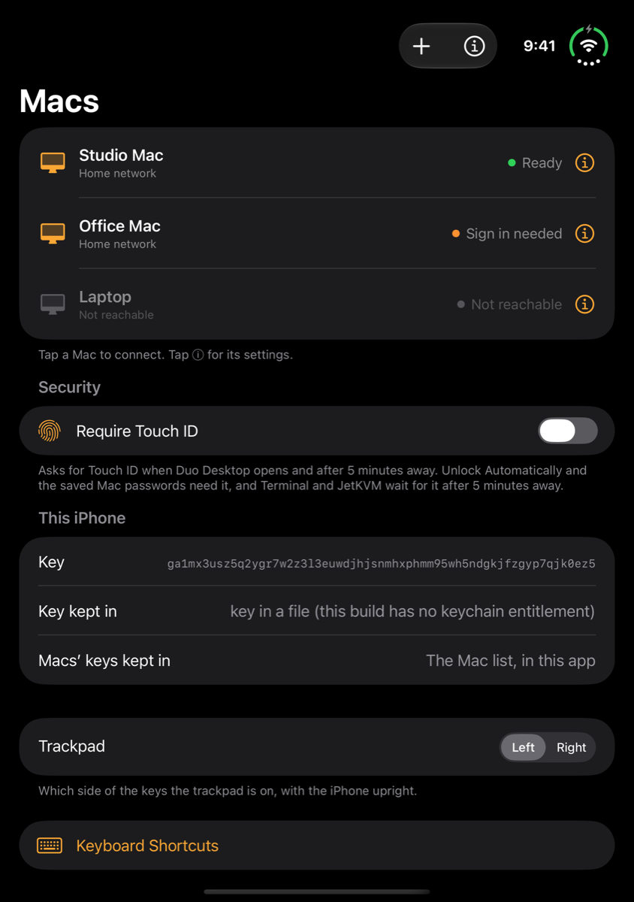
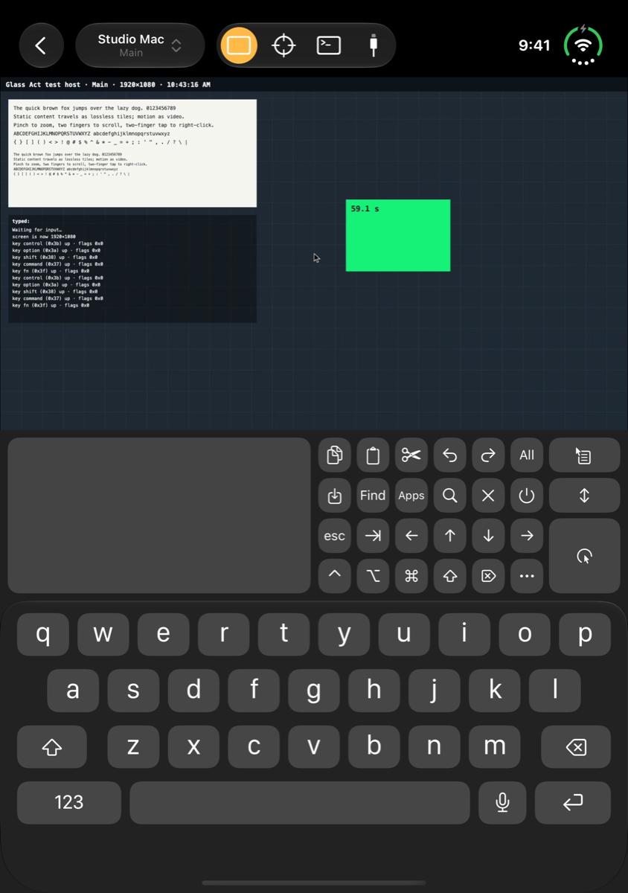
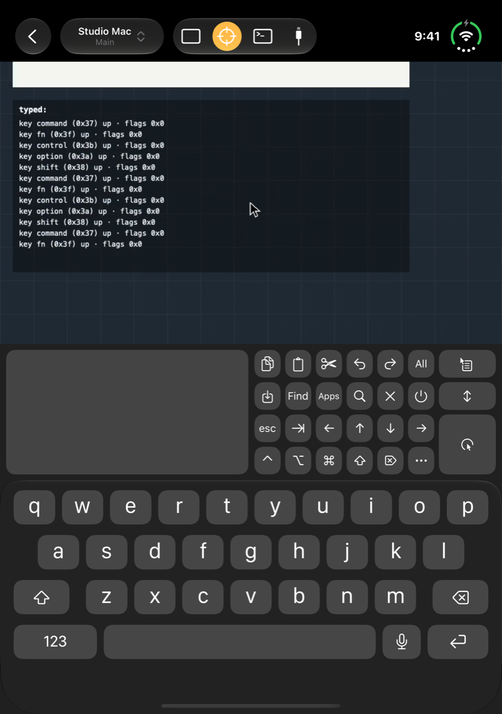
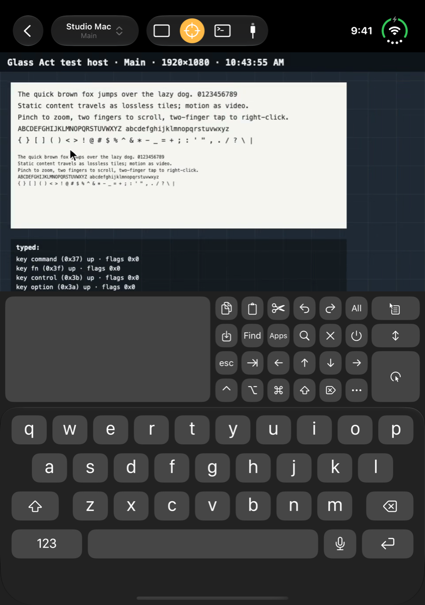
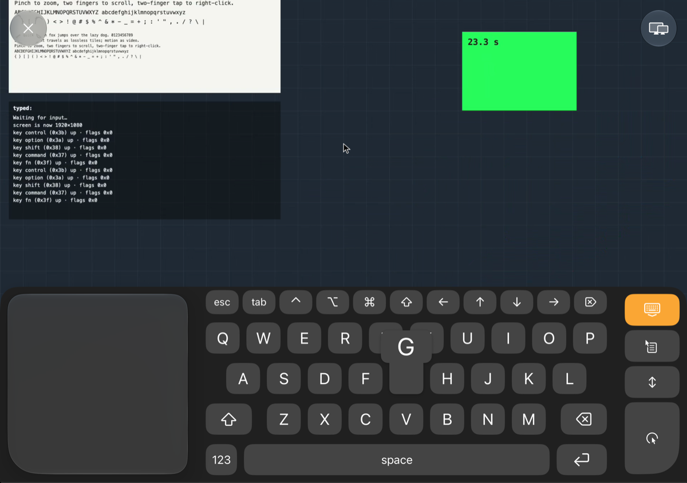
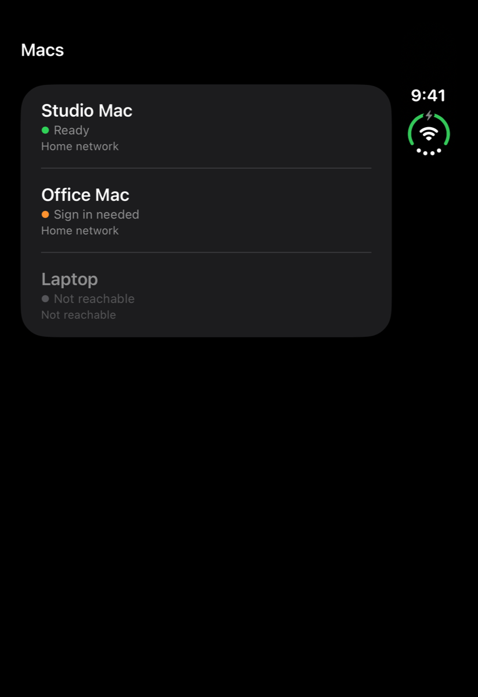
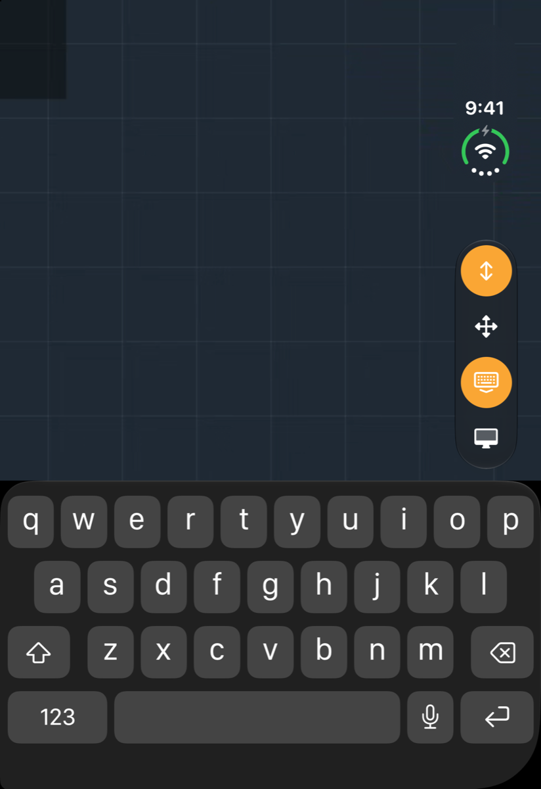
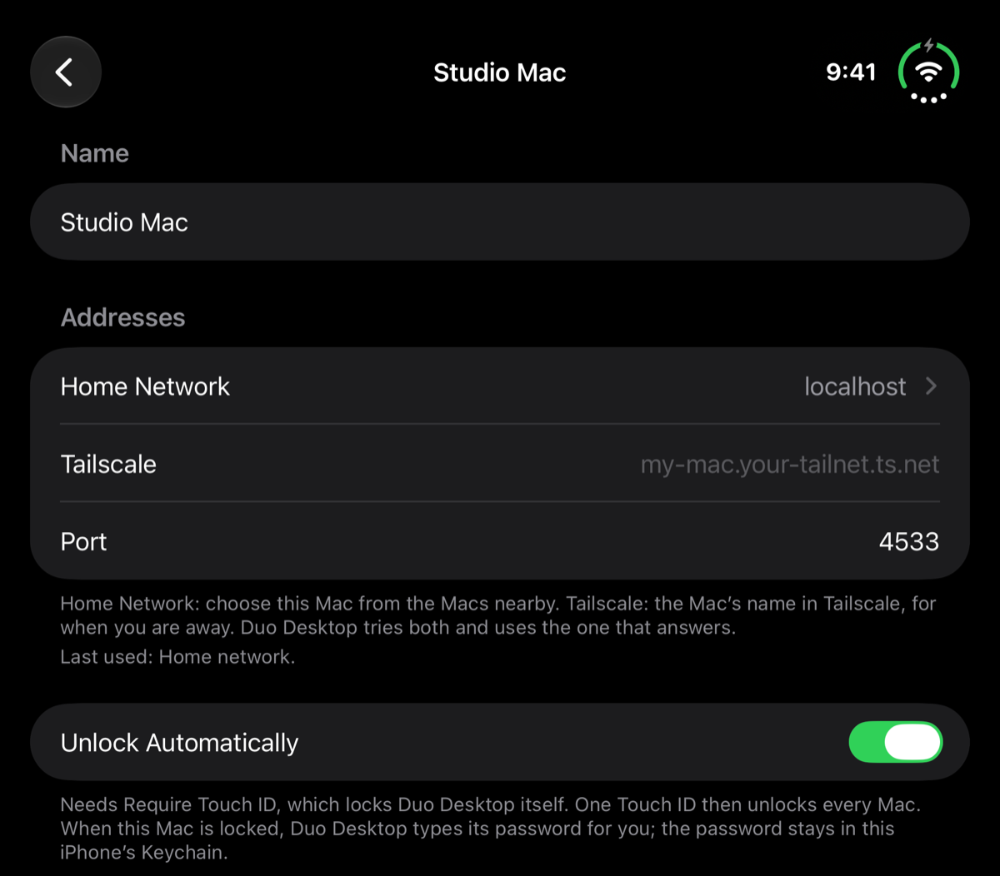
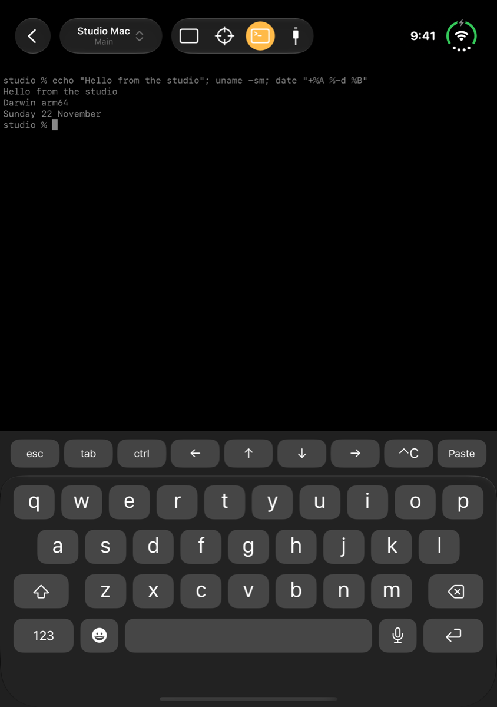
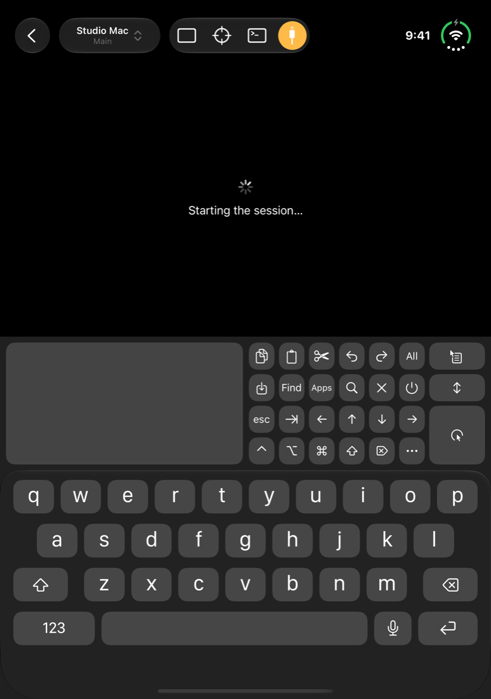

# Duo Desktop

Duo Desktop gives you precise control of a Mac from an iPhone Duo. Open the phone like a book. One half shows the
Mac's screen. The other half is a separate trackpad and keyboard, with a band of Mac keys (Command, Option, arrows,
Copy, Paste, the app switcher and more). You move the pointer with the trackpad, the way you would on a MacBook,
so you can hit small buttons and pick out text without your finger covering it.

It has two parts:

- **The iPhone app** (this repository, folder `app/`).
- **Glass Act Host**, a small program on each Mac. It comes from the open-source
  [Glass Act](https://github.com/brianmario/glassact) project, plus the patches in this repository (folder
  `patches/`).

**Read [Known issues](#known-issues) before you start.** This was built for one person's setup and is not a
finished product. This page describes **build 0.1 (49)**.

*All pictures on this page are the real app, build 49, in the iPhone Duo Simulator. The Macs in them are Glass
Act's test host (a stand-in Mac that draws a test picture) under made-up names. No real Mac is shown.*

Contents:

1. [Your Macs](#your-macs)
2. [Held upright: Whole Screen and Follow Pointer](#held-upright-whole-screen-and-follow-pointer)
3. [Held sideways](#held-sideways)
4. [The outside screen](#the-outside-screen)
5. [More than one screen](#more-than-one-screen)
6. [Keyboard and shortcut keys](#keyboard-and-shortcut-keys)
7. [Unlocking](#unlocking)
8. [Terminal and JetKVM](#terminal-and-jetkvm)
9. [Installing](#installing)
10. [Building](#building)
11. [Security, in plain words](#security-in-plain-words)
12. [Tested on a real phone](#tested-on-a-real-phone)
13. [Known issues](#known-issues)
14. [Licence and third-party notices](#licence-and-third-party-notices)

---

## Your Macs

| | |
|---|---|
|  | **The list of Macs.** Each Mac you added, with its state: **Ready**, **Sign in needed** or **Not reachable**. Tap a Mac to connect. Tap **ⓘ** beside it for its settings. Below the Macs: the **Security** section, the trackpad side, keyboard haptics and **Keyboard Shortcuts**. |

---

## Held upright: Whole Screen and Follow Pointer

With the phone open and held upright, the Mac's picture is on top. The trackpad, the Mac keys band and the keyboard
are below. The top row holds **Back**, the Mac's name with the screen's name under it (the "name bubble"), and the
view choices.

| | |
|---|---|
|  | **Whole Screen.** The whole Mac screen fits the phone. Good for seeing where things are. Small text is small. |

### Follow Pointer: the zoomed-in view

A whole Mac screen on a phone is too small to read. **Follow Pointer** shows only the part around the pointer, at a
readable size. The idea: **the pointer stays put, and the Mac moves under it.** When you move the pointer with the
trackpad, the picture slides instead, so the spot you are working on stays in the middle of the phone. Near an edge
of the Mac's screen the picture stops, and the pointer moves off centre, so you never see empty space past the edge.

Choose it with the crosshair in the top row, or pinch out from Whole Screen.

| | | |
|---|---|---|
|  |  |  |
| **1.** Zoomed in on the text under the pointer. | **2.** The pointer moved down. The picture moved with it; the pointer is still in the middle. | **3.** Near the left edge the picture stops, and the pointer moves off centre. |

**Pinch to change view.** Three levels, one step per pinch: Follow Pointer → (pinch in) → Whole Screen →
(pinch in) → All Screens (only on a Mac with more than one screen). Pinch out to go back. Pinches never move
anything on the Mac.

---

## Held sideways

Turn the open phone sideways for a wide picture of the whole Mac screen. The trackpad sits at one side, and a clear
column of buttons at the other: **Keyboard**, **Right click**, **Scroll** and **Click**.

| |
|---|
|  |
| **Sideways.** The whole Mac screen, the trackpad (bottom left) and the button column (right). |
|  |
| **Typing sideways.** Duo Desktop's own keyboard, with Mac keys along the top (esc, tab, Control, Option, Command, Shift, arrows). Keys show a pop-up of the letter as you press them, like the iPhone's keyboard. Here the G key is held. |

---

## The outside screen

Folded, the phone's outside screen is a **smaller companion view**: for a quick look or a quick answer without
opening the phone. Open the phone for real work.

| | |
|---|---|
|  |  |
| **The Mac list**, compact. | **A Mac, with the keyboard.** Type into the Mac without opening the phone. Buttons at the side. |

The outside view is still being reworked (see [Known issues](#known-issues)).

---

## More than one screen

A Mac with several screens shows them all. The name bubble's second line always says which screen you are on.

| | |
|---|---|
|  | **All Screens.** Every screen of the Mac as a live snapshot, laid out as on the desk. The one you are on is outlined. Tap a screen to go to it. Pinch in from Whole Screen to get here. |
|  | **Picking a screen.** Tap the name bubble in the top row. A menu lists the Mac's screens; choose one. Here the screen called "Top" is shown. The app remembers the last screen for each Mac. |
|  | **Crossing a screen edge.** Push the pointer past the edge of the screen with the trackpad. If another screen sits on that side, the picture slides over to it, as at the Mac. Here the pointer was pushed past the left edge of "Main" and the app is now on "Left 16:10"; the name bubble says so. The pointer carries on from the same height. |

---

## Keyboard and shortcut keys

| | |
|---|---|
|  | **The Mac keys band.** Command, Option, Control, Shift, arrows, Copy, Paste, the app switcher and more. **··· (More)** swaps in F1–F12, Home, End, Page Up and Page Down. Tap **Keyboard** for the phone's keyboard; what you type goes to the Mac. |
|  | **Keyboard Shortcuts.** A sheet listing every button and key and what it does. Open it from the list of Macs. |

**Gestures.** On the trackpad: one finger moves the pointer, a tap clicks, a two-finger tap right-clicks, two
fingers scroll; tap, then touch and hold, then move, to drag. On the picture: a tap clicks where you touch; touch
and hold, then lift, right-clicks; three-finger swipes are Mission Control, App Exposé and Spaces; a swipe in from
the top or bottom edge shows a hidden menu bar or Dock.

---

## Unlocking

| | |
|---|---|
|  | **A Mac's settings** (tap ⓘ beside a Mac). **Unlock Automatically**: when the Mac's screen is locked, Duo Desktop types its password for you. The password stays in this iPhone's Keychain. |

- **Require Touch ID** locks Duo Desktop itself. It is in the **Security** section of the Mac list, on by default.
  It asks for Touch ID when the app opens and after 5 minutes away.
- **Unlock Automatically needs Require Touch ID.** One Touch ID then unlocks every Mac. The Mac's settings say so.
  When Require Touch ID is off, a **Turn On Require Touch ID** button sits right under the switch.
- Turning Require Touch ID off while Macs use Unlock Automatically warns first and names those Macs. Their saved
  passwords are then deleted from the phone.
- **Home Network** in a Mac's settings: tap it to pick the Mac from those nearby, or type an address.

---

## Terminal and JetKVM

Two optional views, each added by a build switch (see [Building](#building)) and then turned on per Mac in its
settings. The plain build contains no Terminal or JetKVM code at all.

| | |
|---|---|
|  | **Terminal.** A command line on the Mac over SSH, inside tmux so it survives the phone sleeping, with a row of terminal keys. Needs Remote Login on at the Mac. The Host adds the phone's SSH key for you. If a sign-in fails, the view says why (for example a wrong user name) and offers the Mac's settings. |
|  | **JetKVM.** The Mac's screen through a [JetKVM](https://jetkvm.com) box plugged into it (HDMI and USB). It works even while the Mac starts up, sleeps or is stuck, when the Host cannot. Shown here while it connects. It retries by itself and keeps a log. |

**When the JetKVM view starts**, it says which step it is on: **Signing in…**, **Starting the session…**,
**Waiting for the picture…**. If the video connection does not form (or no picture arrives within 12 seconds), it
starts a new attempt 3 seconds later, by itself, up to 3 attempts (**Trying again (2 of 3)…**), then shows the
reason and **Try Again**. A wrong password or an unreachable address is shown at once. What happened is in that
Mac's **JetKVM Log**.

Both views obey the app's lock, also while a connection is still starting. More in the
[install guide](docs/INSTALL.md#settings-for-each-mac).

---

## Installing

**A ready-to-install Host exists for each TestFlight build.** It is signed with Developer ID and notarized by
Apple, so it opens without Gatekeeper's extra step and you do not need to build it yourself. It is attached to this
repository's [Releases](https://github.com/Stratechery/duo-desktop/releases). The current one, "Glass Act Host
26.11.3 for Duo Desktop 48", also serves build 49: build 49 did not change the Host. You can also build the Host
yourself, as the guide describes.

The full, step-by-step guide is in **[docs/INSTALL.md](docs/INSTALL.md)**:

- [What you need](docs/INSTALL.md#what-you-need): an iPhone Duo on iOS 27, a Mac with Xcode 27.2, Macs on macOS
  15.5 or later, an Apple developer account.
- [Install the Host on a Mac](docs/INSTALL.md#install-the-host-on-a-mac): get Glass Act, apply the patches, build,
  sign, the two permissions (Screen Recording, Accessibility), the firewall question, Open at Login, updating,
  uninstalling.
- [First connection](docs/INSTALL.md#first-connection): Add Mac, signing in once, what each state means.
- [Settings for each Mac](docs/INSTALL.md#settings-for-each-mac).

## Building

One code base, four versions. You choose when you make the Xcode project:

| You want | Make the project with |
|---|---|
| **Plain** (screen sharing only) | `xcodegen generate` |
| **Terminal** | `DUO_TERMINAL=YES xcodegen generate` |
| **JetKVM** | `DUO_JETKVM=YES xcodegen generate` |
| **Both** | `DUO_TERMINAL=YES DUO_JETKVM=YES xcodegen generate` |

The steps (Glass Act for the app, your bundle id and team, the Simulator, your phone, TestFlight) are in
[Build the iPhone app](docs/INSTALL.md#build-the-iphone-app).

---

## Security, in plain words

- **Outside review.** The code had two rounds of outside review. The second round's three items are fixed in this
  build.
- **What the Host trusts.** Only phones (and Glass Act viewers) that were approved on that Mac: by the Mac's user
  name and password once, or by you at the Mac. Each approved phone is known by its own key, kept on the phone.
  Anyone else is refused before they see anything.
- **Keys are pinned.** The phone remembers each Mac's Host key on first contact. If a different key answers at the
  same address, the app refuses to connect ("This isn't the Mac you added.").
- **The connection is encrypted**: picture, input and clipboard travel over QUIC with TLS 1.3, end to end between
  phone and Host. There is no unencrypted mode. Someone watching the network can see that a connection exists, not
  what is on it. (This is Glass Act's design; see its
  [security notes](https://github.com/brianmario/glassact#security).)
- **Sign-in:** the Mac's password travels encrypted, only to the Mac key the phone trusts, and is not stored by the
  app. The Host limits wrong-password tries.
- **The phone's own key** is kept in the Keychain (Secure Enclave) on a signed phone build; in the Simulator, in a
  file.
- **What an approved phone can do:** see the shared screen; move the pointer, click and type as the Mac's user;
  copy and paste; type the Mac's password into its lock screen (with Unlock Automatically); and, for the Terminal,
  add the phone's SSH key to that user's `~/.ssh/authorized_keys`, which gives a shell as that user. In short: an
  approved phone can do what the person at the Mac can do.
- **Before the Host adds an SSH key**, it checks three things: the phone is an approved viewer that may control the
  Mac (not View Only); the Host's own record says so (its list of approved viewers, written only when the Mac's
  user approves, never taken from what the phone claims); and the request came over the very connection that
  belongs to that approved phone. If the record does not say (an approval from an older Host), the Mac asks its
  owner once (see [Settings for each Mac](docs/INSTALL.md#settings-for-each-mac)). Treat approving a phone like handing over your
  keyboard. Set a phone to **View Only** in the Host's **Viewers** menu to allow watching only.
- **On the phone:** Mac passwords and the JetKVM password live in the iPhone's Keychain, this device only.
  **Require Touch ID** locks the app; while locked, nothing connects and no password is read.
- **Network:** use it on your own network or Tailscale. Do not forward UDP 4433/4434 from the internet.
- **JetKVM:** the JetKVM's own login is plain `http://` (as the device offers it). Reach it only over your home
  network or Tailscale.

---

## Tested on a real phone

The owner tested on a real iPhone Duo on 2026-11-21 and reported:

- **Unlock Automatically** works.
- The **Terminal** view works.
- The **JetKVM** view works.
- **Keyboard sounds and haptics** work.

Those reports were on builds 45 to 47. Nothing else is claimed here. Everything else was tested in the Simulator or against Glass Act's test host.

---

## Known issues

- **Built for one setup.** Tuned for the iPhone Duo and Macs whose screens look like 1920 points wide. Other
  sizes work but were not tuned. There is no support.
- **The folded (outer screen) view and the narrow-window behaviour are being reworked.** Expect them to change and
  to have rough edges.
- **The JetKVM connection is intermittent.** Sometimes the video connection does not form ("ICE failed"). The
  JetKVM's own web page in a browser has the same problem. What was found:
  - The JetKVM's log showed that, in the failed sessions, it had **none of the phone's network addresses**.
  - A likely cause on the app's side: the app could send its network addresses before its connection offer, and
    the JetKVM (firmware 0.5.10) throws away addresses that arrive before the offer. The app now always sends the
    offer first. This is a likely fix, not a proven one.
  - In the browser, Safari hides its own addresses behind made-up `.local` names, which the JetKVM cannot look up
    over Tailscale. That is a separate, similar fault.
  - The JetKVM's cloud service was suspected of racing with Tailscale. The device's log does not support that (no
    cloud video sessions), but it is not fully ruled out.
  - No newer JetKVM firmware was found that changes this.
  - Meanwhile the app retries by itself (see [Terminal and JetKVM](#terminal-and-jetkvm)), and the **JetKVM Log** shows
    what happened.
- **Not proven on a real phone:** anything not listed under [Tested on a real phone](#tested-on-a-real-phone),
  including that the JetKVM retry and the offer-first change fix the intermittent connection, build 48's
  changes (the Mac's one-time question, the lock while starting, the JetKVM failure reported at once) and build
  49's (the Security section, picking the home address from nearby Macs, the SSH user name warnings).
- **Host on macOS 15:** a first-start crash of the setup window was fixed (the last patch); macOS 15 had only one
  test Mac.
- **Host settings while a session runs:** if someone at the Mac makes another screen the main one during a
  session, the picture stays on the old screen until the next session.
- The app calls itself "duo-screens" in a few internal names (the project's old name); harmless.

---

## Licence and third-party notices

Duo Desktop's own code is under the **MIT licence**: see [LICENSE](LICENSE). Third-party notices are in
[NOTICE.md](NOTICE.md) and shown in the app under About.

- **Glass Act** (https://github.com/brianmario/glassact), MIT, Copyright (c) 2026 Brian Lopez. Patched at build
  time (folder `patches/`); two app files are adapted from it and keep its header. Inside it: libwebp
  (BSD-3-Clause), libaom (BSD-2-Clause, Alliance for Open Media Patent License 1.0).
- **SwiftTerm** (https://github.com/migueldeicaza/SwiftTerm), MIT. Terminal versions only.
- **swift-nio-ssh** (https://github.com/apple/swift-nio-ssh), Apache-2.0, with its packages swift-nio,
  swift-crypto, swift-asn1, swift-atomics, swift-collections and swift-system (Apache-2.0). Terminal versions only.
- **WebRTC** (https://webrtc.org), BSD-style with a patent grant, packaged by
  https://github.com/stasel/WebRTC (BSD-3-Clause). JetKVM versions only.
- The JetKVM client in `jetkvm-client/` contains no JetKVM code (that is GPL-2.0); it was written from the message
  layouts only. See [jetkvm-client/LICENSES.md](jetkvm-client/LICENSES.md).
