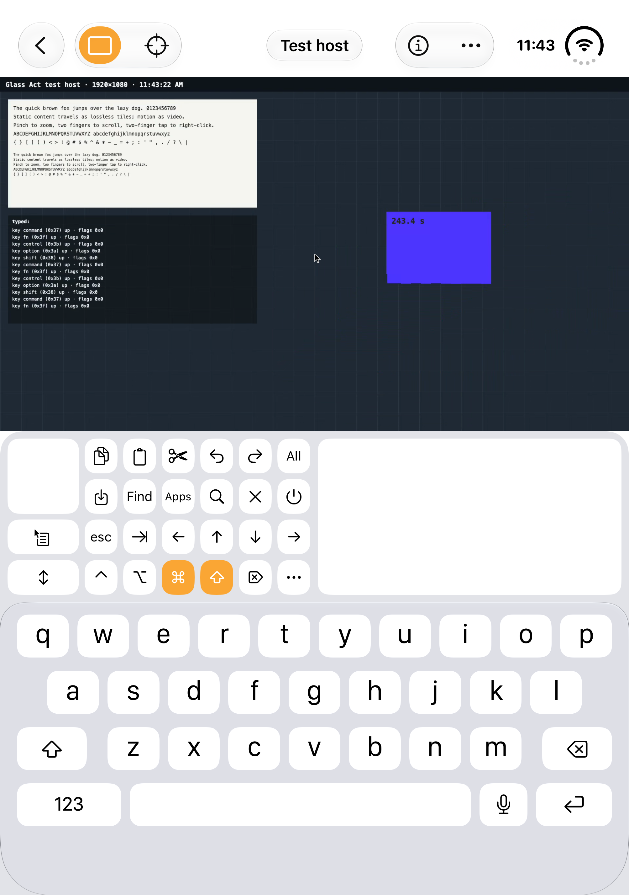

# Duo Desktop

Duo Desktop is an iPhone app for using your Mac from an iPhone Duo. It shows the Mac's screen on the phone.
You work the Mac with a trackpad, the phone's keyboard and a band of Mac keys (Command, Option, arrows, Copy,
Paste, the app switcher and more).

It has two parts:

- **The iPhone app** (this repository, folder `app/`).
- **Glass Act Host**, a small program on each Mac. It comes from the open-source
  [Glass Act](https://github.com/brianmario/glassact) project. You build it yourself from Glass Act's code plus
  the patches in this repository (folder `patches/`).



*An earlier build of the app in the iPhone Duo Simulator, connected to Glass Act's test host (a stand-in Mac that
draws a test picture). No real Mac is shown.*

**Read [Known issues](#known-issues) before you start.** This was built for one person's setup and is not a
finished product.

This guide describes **build 0.1 (48)**.

**A ready-to-install Host exists for each TestFlight build.** It is signed with Developer ID and notarized by
Apple, so it opens without Gatekeeper's extra step and you do not need to build it yourself. It will be attached to
this repository's [Releases](https://github.com/Stratechery/duo-desktop/releases) when the repository is published.
Until then, build the Host as described below.

Contents:

1. [What you need](#what-you-need)
2. [The versions: plain, Terminal, JetKVM](#the-versions-plain-terminal-jetkvm)
3. [Install the Host on a Mac](#install-the-host-on-a-mac)
4. [Build the iPhone app](#build-the-iphone-app)
5. [First connection](#first-connection)
6. [Settings for each Mac](#settings-for-each-mac)
7. [Using it](#using-it)
8. [Security, in plain words](#security-in-plain-words)
9. [Tested on a real phone](#tested-on-a-real-phone)
10. [Known issues](#known-issues)
11. [Licence and third-party notices](#licence-and-third-party-notices)

A note on the commands below: each one was run while writing this guide, from a fresh copy of this repository,
unless it says **(not run here)** with the reason.

---

## What you need

- **An iPhone Duo** running iOS 27 or later. (The app also runs in the iPhone Duo Simulator, without a real Mac.)
- **A Mac to build on**, with Apple silicon and **Xcode 27.2** or later. (This guide was checked with Xcode 27.2
  on macOS 27.)
- **XcodeGen**, which makes the Xcode project. **(not run here: already installed)**

  ```sh
  brew install xcodegen
  ```

- **Rust from rustup**, for Glass Act's video decoder. The build adds the targets it needs by itself.
  **(not run here: already installed)**

  ```sh
  brew install rustup
  ```

  ```sh
  rustup-init
  ```

- **An Apple developer account.** You need it to put the app on your phone and to sign the Host so its
  permissions stick. A free account may be enough for your own phone **(not tried here)**; TestFlight and
  Developer ID need the paid Apple Developer Program.
- **Each Mac you want to use:** Apple silicon, **macOS 15.5 or later** (the Host's minimum).
- **A private network** between phone and Macs: your home network, or [Tailscale](https://tailscale.com) to reach
  a Mac away from home. Never open the Host's ports to the internet.

## The versions: plain, Terminal, JetKVM

One code base, four versions. You choose when you make the Xcode project, with two switches:

| You want | Make the project with | What is added |
|---|---|---|
| **Plain** (screen sharing only) | `xcodegen generate` | nothing; Glass Act only |
| **Terminal** | `DUO_TERMINAL=YES xcodegen generate` | a Terminal view per Mac (SwiftTerm, swift-nio-ssh) |
| **JetKVM** | `DUO_JETKVM=YES xcodegen generate` | a JetKVM view per Mac (WebRTC, about 12.5 MB) |
| **Both** | `DUO_TERMINAL=YES DUO_JETKVM=YES xcodegen generate` | all of the above |

- **Terminal** opens a command line on the Mac over SSH, for when you want a shell rather than the screen.
- **JetKVM** shows a Mac through a [JetKVM](https://jetkvm.com) box plugged into it (its HDMI and USB). That works
  even when the Mac is starting up, asleep or stuck, where the Host cannot.

The plain version contains no Terminal or JetKVM code at all. The files `app/project-terminal.yml` and
`app/project-jetkvm.yml` are the two switches; `app/project.yml` includes each only when its variable is `YES`.

---

## Install the Host on a Mac

You build the Host once, on your build Mac, then copy it to each Mac you want to use.

### Step 1. Get this repository

```sh
git clone https://github.com/Stratechery/duo-desktop.git
```

```sh
cd duo-desktop
```

You should see the folders `app`, `host`, `jetkvm-client`, `patches`. (If the repository is private, you need to
be signed in to GitHub with access to it.)

### Step 2. Get Glass Act and apply the patches

```sh
host/prepare-host.sh
```

This downloads Glass Act into `vendor/glassact-host`, moves it to the pinned commit
(`486f11518da42d3ff7fac840a7bb9881d1425ca9`, in `app/GLASSACT_COMMIT`) and applies the ten patches listed in
`patches/HOST_PATCHES`, in order.

You should see one `applied …patch` line for each of the ten, then:

```
ready: …/vendor/glassact-host (Glass Act 486f11518da42d3ff7fac840a7bb9881d1425ca9 + 10 patches)
```

If it stops:
- `already exists`: delete `vendor/glassact-host` and run it again.
- `patch does not apply`: your Glass Act is not at the pinned commit. Delete `vendor/glassact-host` and run it
  again. Do not change the commit; the patches are made for that one.

What the patches do is in [patches/README.md](patches/README.md).

### Step 3. Find your signing certificate

macOS ties the Host's permissions (Screen Recording, Accessibility) to its signature. Sign every build with the
same certificate, or the Mac forgets the permissions each time.

```sh
security find-identity -v -p codesigning
```

You should see one or more lines like `1) 1A2B… "Apple Development: Your Name (ABCDE12345)"`. Copy the part in
quotes. If you see `0 valid identities found`, open Xcode › Settings › Accounts, add your Apple account, choose
your team and click **Manage Certificates…** › **+** › **Apple Development**.

You also need your **team id** (10 characters). It is in Xcode › Settings › Accounts (select the team), or on
https://developer.apple.com/account under Membership details.

**Apple Development or Developer ID?** Both work for the build. They differ when the app reaches another Mac:

| | Apple Development | Developer ID Application (paid program) |
|---|---|---|
| Who can make it | any developer account | paid Apple Developer Program only |
| Copied to a Mac with `ditto`, `scp` or over SSH | opens normally | opens normally |
| Downloaded (browser, AirDrop, chat app) | macOS blocks it the first time (see Step 6) | opens normally once notarized |
| Mac firewall, if it is on | asks "accept incoming connections?" | allowed without asking (signed software is allowed by default) |

Why you cannot just hand a built Host to someone else: with an Apple Development signature, macOS blocks a
downloaded copy at first open, and the firewall asks about it. To give someone a ready-made Host that simply
opens, you need a Developer ID certificate, then Apple's notarization (`xcrun notarytool submit`, then
`xcrun stapler staple`), then a zip or disk image. This repository does not do that. **(not run here)**

### Step 4. Build the Host

```sh
host/build-host.sh vendor/glassact-host "Apple Development: Your Name (ABCDE12345)" ABCDE12345 com.yourname.glassact
```

The four parts: the folder from Step 2, your certificate name from Step 3, your team id, and a bundle prefix of
your own (the Host's bundle id becomes `com.yourname.glassact.host`).

It takes several minutes the first time (it also builds Glass Act's Rust video code). Xcode's output scrolls by.
At the end you should see:

```
built: …/vendor/glassact-host/.host-build/Build/Products/Release/Glass Act Host.app
```

The script also:
- turns off Glass Act's automatic updates (an update from upstream would replace your patched Host), and checks
  the built app has no update key;
- builds without a keychain entitlement, so no provisioning profile is needed. The Host keeps its own key in a
  file in `~/Library/Application Support/Glass Act/`, readable only by that user;
- checks the signature (`codesign --verify --deep --strict`).

If it fails:
- `No signing certificate … found`: the certificate name is not exactly as Step 3 printed it.
- `cargo: command not found` or a Rust error: install rustup (see [What you need](#what-you-need)) and open a new
  Terminal window.
- `xcodebuild: error: … requires Xcode`: run `sudo xcode-select -s /Applications/Xcode.app` **(not run here: it
  changes the Mac's settings)**.

### Step 5. Put it on the Mac

Do this on each Mac, logged in as the person whose screen you want to see. **(not run here: this guide installs
nothing)**

If you built on this Mac:

```sh
ditto "vendor/glassact-host/.host-build/Build/Products/Release/Glass Act Host.app" "/Applications/Glass Act Host.app"
```

To copy it to another Mac over SSH (it arrives without the "downloaded" flag, so it opens normally); replace
`other-mac` with that Mac's name:

```sh
tar -C "vendor/glassact-host/.host-build/Build/Products/Release" -cf - "Glass Act Host.app" | ssh other-mac 'tar -C /Applications -xf -'
```

Optional, before the first start: stop the Mac from announcing itself to phones on the same network. With this
off, you add the Mac by typing its address instead. (Use your own bundle prefix.)

```sh
defaults write com.yourname.glassact.host glassact.host.visibleNearby -bool false
```

### Step 6. First start

```sh
open "/Applications/Glass Act Host.app"
```

**(not run here)** You should see a new icon in the menu bar (a screen with a line through it until permissions
are granted) and a setup window with one button per permission.

If macOS says the app "cannot be opened" or "could not verify": the copy arrived with the download flag. Open
**System Settings › Privacy & Security**, scroll down to the message about Glass Act Host and click
**Open Anyway**, then confirm. Or copy it again as in Step 5.

### Step 7. Grant the two permissions

At the Mac, in **System Settings › Privacy & Security**:

1. **Screen & System Audio Recording**: switch on **Glass Act Host**. macOS offers **Quit & Reopen**: choose it.
2. **Accessibility**: switch on **Glass Act Host**. (On macOS 27 this pane is called **Device Control and Data
   Access**.) This lets the phone move the pointer and type.

The setup window's buttons open the right pane. The Host does not accept connections until Screen Recording is
on. When both are on, the menu-bar icon no longer has the line through it.

### Step 8. The firewall question

If the Mac's firewall is on (System Settings › Network › Firewall), the first time a phone connects macOS asks:
*Do you want the application "Glass Act Host.app" to accept incoming network connections?* Click **Allow**.

Until someone answers, the phone sees **Not reachable**, and the box can hide behind other windows. To check
whether the firewall is on:

```sh
/usr/libexec/ApplicationFirewall/socketfilterfw --getglobalstate
```

You should see `Firewall is enabled` or `Firewall is disabled`.

To answer the question from Terminal instead (asks for an administrator password) **(not run here: it changes the
firewall)**:

```sh
sudo /usr/libexec/ApplicationFirewall/socketfilterfw --add "/Applications/Glass Act Host.app"
```

```sh
sudo /usr/libexec/ApplicationFirewall/socketfilterfw --unblockapp "/Applications/Glass Act Host.app"
```

Or in System Settings › Network › Firewall › **Options…**: find Glass Act Host (or add it with **+**) and set it to
**Allow incoming connections**.

### Step 9. Open at Login

The Host turns on Open at Login by itself the first time it runs from `/Applications`. macOS shows "Login Item
Added". To turn it off: the Host's menu › **Options** › **Open at Login**, or System Settings › General › Login
Items & Extensions.

### The Host's menu

Click the Host's menu-bar icon:

- **New Viewers**: what happens when a new phone tries to connect:
  - **Sign In with This Mac's Password** (default): the phone asks for this Mac's user name and password once.
  - **Ask Me Each Time**: the Mac shows a dialog with a code to compare; you approve at the Mac.
  - **Don't Allow**: only phones already approved can connect.
- **Viewers**: the phones and computers you approved. Rename, set one to **View Only**, or forget one.
- **Options**: **Lock Screen When Viewer Leaves**, **Visible to Nearby Viewers** (announces the Mac to phones on
  the same network), **Open at Login**, **Permissions…**.
- **Quit Glass Act Host**.

### Check that it is running and listening

```sh
pgrep -lx "Glass Act Host"
```

You should see a number and `Glass Act Host`. Nothing means it is not running: open it (Step 6).

```sh
lsof -nP -a -p "$(pgrep -x 'Glass Act Host')" -iUDP 2>/dev/null
```

You should see a line ending `UDP *:4433`. Nothing means it is running but not listening: Screen Recording is
not on yet (Step 7). (The Host uses UDP 4433, and 4434 for the picture during a session.)

```sh
/usr/bin/log show --last 1d --predicate 'subsystem == "app.glassact.host"' | grep listening
```

You should see `listening on 4433 — capturing only while a viewer is connected`.

### Update to a newer Host

Build the new one (Steps 2 to 4; delete `vendor/glassact-host` first so Step 2 starts clean). Then, on each Mac
**(not run here)**:

```sh
osascript -e 'tell application "Glass Act Host" to quit'
```

```sh
rm -rf "/Applications/Glass Act Host.app"
```

Then copy the new one in (Step 5) and open it (Step 6). Remove the old app first; do not copy over it.

If you signed with the **same certificate** and bundle prefix, the permissions and the approved phones carry over:
nothing to click. With a different certificate, macOS asks for both permissions again.

### Uninstall

On the Mac **(not run here)**:

```sh
osascript -e 'tell application "Glass Act Host" to quit'
```

```sh
rm -rf "/Applications/Glass Act Host.app"
```

Its key and the list of approved phones:

```sh
rm -rf "$HOME/Library/Application Support/Glass Act"
```

Its settings (your bundle prefix):

```sh
defaults delete com.yourname.glassact.host
```

Then in System Settings › Privacy & Security, remove Glass Act Host from Screen & System Audio Recording and from
Accessibility with the **–** button, and from Login Items & Extensions if it is still listed.

---

## Build the iPhone app

### Step 1. Get Glass Act for the app

From the repository's top folder:

```sh
app/scripts/fetch-glassact.sh
```

This downloads Glass Act into `vendor/glassact` and applies the first nine patches (`app/GLASSACT_PATCHES`). You
should see:

```
glassact pinned at 486f11518da42d3ff7fac840a7bb9881d1425ca9 + 9 patches, exact outside Apps/
```

The app's build runs the same check each time and refuses a Glass Act copy with any other change. Keep
`vendor/glassact` (app) and `vendor/glassact-host` (Host) separate.

### Step 2. Set your bundle id and team

Open `app/project.yml` and change the two lines marked `CHANGE THIS`:

```yaml
    DUO_BUNDLE_ID: com.yourname.duodesktop
    DEVELOPMENT_TEAM: ABCDE12345
```

(The Simulator build does not need either; you can skip this step to try the app in the Simulator.)

### Step 3. Make the Xcode project

```sh
cd app
```

Then one of these (see [The versions](#the-versions-plain-terminal-jetkvm)):

```sh
xcodegen generate
```

```sh
DUO_TERMINAL=YES xcodegen generate
```

```sh
DUO_JETKVM=YES xcodegen generate
```

```sh
DUO_TERMINAL=YES DUO_JETKVM=YES xcodegen generate
```

You should see `Created project at …/app/DuoDesktop.xcodeproj`. Make the project again whenever you switch
version.

### Step 4. Build for the Simulator (optional)

```sh
xcodebuild -project DuoDesktop.xcodeproj -scheme DuoDesktop -destination 'generic/platform=iOS Simulator' -skipPackagePluginValidation build
```

You should see `** BUILD SUCCEEDED **`. `-skipPackagePluginValidation` is needed for the Terminal versions
(SwiftTerm has a build plugin); it does no harm in the others. The first build takes several minutes (Rust).

To run the unit tests (needs an iPhone Duo simulator; Xcode › Window › Devices and Simulators › **+**):

```sh
xcodebuild -project DuoDesktop.xcodeproj -scheme DuoDesktop -destination 'platform=iOS Simulator,name=iPhone Duo' -skipPackagePluginValidation test
```

You should see `Executed … tests` and `** TEST SUCCEEDED **`. On a newly made simulator, two layout tests in
`TopRowTests` fail (5 failures: `testPictureStartsAtTheBottomOfTheTopRowAndTheRowIsTheClocksRow` and
`testRowOrderBackNameSwitchNoInfoAndNothingOverlaps`). They measure the screen's top row, and a simulator that has
never been opened and unfolded on screen has none. Open the simulator in the Simulator app, unfold it, and run
again. (Seen here on a newly made simulator; the same tests pass on a simulator in daily use. The unfold step
itself was not tried here.)

In the Simulator (only there), the Mac list has a **Test host** entry. It connects to Glass Act's stand-in host on
the same Mac, port 4533: `glassact-testhost --port 4533 --sign-in-password duotest`, built from `vendor/glassact`
(see the comments in `app/DuoDesktopUITests`). **(not run here)** A build for a phone starts with an empty list.

### Step 5. Run on your iPhone Duo

**(not run here: needs your team and your phone)**

1. Connect the phone to the Mac with a cable, or pair it over Wi-Fi in Xcode (Window › Devices and Simulators).
   On the phone, turn on **Settings › Privacy & Security › Developer Mode** if asked, and restart.
2. Open the project:

   ```sh
   open DuoDesktop.xcodeproj
   ```

3. In Xcode, choose your phone at the top of the window, then **Product › Run**.
4. The first time, the phone may say the developer is not trusted: **Settings › General › VPN & Device
   Management**, tap your developer account, **Trust**.

If Xcode says signing failed: check Step 2 (your team id, and a bundle id nobody else has used), and that your
account is added in Xcode › Settings › Accounts.

### TestFlight (optional)

With the paid Apple Developer Program you can send the app to your phone (or others) through TestFlight: create
the app in [App Store Connect](https://appstoreconnect.apple.com) with your bundle id, raise
`CURRENT_PROJECT_VERSION` in `app/project.yml` for each upload, then in Xcode **Product › Archive** and
**Distribute App** › **TestFlight**. **(not run here)** The JetKVM versions need the camera and microphone
purpose texts already in `app/project-jetkvm.yml` (the WebRTC library mentions those APIs; the app never uses
them), or App Store Connect refuses the upload.

---

## First connection

1. Open Duo Desktop. Unfolded, the list of Macs is empty: **No Macs Yet**.
2. Tap **Add Mac**.
   - **On This Network** lists Macs on the same network whose Host has **Visible to Nearby Viewers** on. Tap one.
     The first time, the phone asks to use the local network: allow it.
   - **Or Type an Address**: a Tailscale name (`my-mac`), a full Tailscale name (`my-mac.your-tailnet.ts.net`) or a
     home name (`My-Mac.local`). The port is 4433 unless you changed it.
3. The Mac appears in the list with its state under its name:
   - **Ready**: tap it to connect.
   - **Sign in needed**: tap it and sign in with **the Mac's own user name and password**, once. The Host checks
     them and remembers this phone; the password is not stored by the app.
   - **Asks on the Mac**: the Host is set to Ask Me Each Time. Tap to connect, then approve at the Mac after
     comparing the code.
   - **Not taking new viewers**: the Host is set to Don't Allow.
   - **Not reachable**: no Host answered. The usual causes:
     - the Host is not running, or Screen Recording is not on yet (see [Check that it is running](#check-that-it-is-running-and-listening));
     - the Mac's firewall is waiting for an answer (see [Step 8](#step-8-the-firewall-question));
     - phone and Mac are on different networks (away from home without Tailscale), or the name is wrong;
     - the Mac is asleep.
   - **This isn't the Mac you added.**: a different Mac (a different Host key) answered at that address. The app
     refuses it. If you really reinstalled the Host and deleted its key, use **Forget Key** in that Mac's settings.
4. Each Mac can have two addresses (for example a home name and a Tailscale name). The app tries both and uses the
   one that answers.

**Away from home: Tailscale (optional).** Install [Tailscale](https://tailscale.com/download) on the phone and on
the Macs, signed in to the same account (tailnet). Add the Mac by its Tailscale name. Nothing else is needed: no
router or port changes.

---

## Settings for each Mac

In the Mac list, tap **ⓘ** beside a Mac.

- **Name, Addresses, Port.**
- **Mac's Key**: the Host's identity the phone trusts for this Mac. **Forget Key** only if that Mac's Host was
  reinstalled with a new key.
- **Unlock Automatically**: when this Mac's screen is locked, the app types its password for you. Needs a
  passcode and Touch ID on the phone and **Require Touch ID** on in the app's settings. The password is kept
  **only in this iPhone's Keychain**: this device only, never synced to iCloud, readable only after Touch ID.
  It is sent to the Host only when the Mac's screen is locked; the Host types it only if the screen is still
  locked, and never logs it.
- **Terminal** (Terminal versions): adds a Terminal view for this Mac.
  - On the Mac, turn on **System Settings › General › Sharing › Remote Login**.
  - The phone makes its own SSH key and asks the Host to add it to that Mac account's `~/.ssh/authorized_keys`. The
    Host does this only for a phone the Mac's user approved and that may control the Mac (not View Only). No
    password is needed.
  - The Mac may ask its owner once. If the phone was approved by an older Host, that approval does not say whether
    it was for a person's phone, so the Host does not assume. The first time the phone sends its key, the Mac shows
    **"Allow <device> to add its SSH key to this Mac?"** with **Don't Allow** and **Allow**. Meanwhile the app says
    **Approve on the Mac** (it waits up to 3 minutes). The Mac remembers the answer, so it asks only once. If the
    answer was Don't Allow, the app says the Mac's user did not allow this device to add SSH keys; approving the
    phone again in the Host's dialog clears that.
  - If the Host is older and does not answer, after 4 seconds the app offers to sign in with the Mac's password,
    or to copy the phone's key so you can add it yourself (**Copy This Phone's Key**).
  - With [tmux](https://github.com/tmux/tmux) on the Mac (`brew install tmux`), your shell survives reconnects.
    Optional.
- **JetKVM** (JetKVM versions): adds a JetKVM view for this Mac. Set the JetKVM's **Address** (its name or IP
  address) and **Password** (the JetKVM's own web password; kept in this iPhone's Keychain only). Opening the
  JetKVM view takes over from anyone else viewing that JetKVM. **Known limit:** its connection sometimes fails
  to start (see [Known issues](#known-issues)). The app then tries again by itself (see
  [The JetKVM view](#the-jetkvm-view)).
- **JetKVM Log** (JetKVM versions, under the JetKVM address): the last 30 lines of what the JetKVM connection did,
  with a **Copy** button. Useful when the view does not start. It never contains the password. The JetKVM's address
  is shown only by its first name part (an IP address shows as "the JetKVM"), and network addresses are listed by
  kind only (for example "host udp tailnet").
- **Remove Mac**: deletes its key and settings from this iPhone. The Mac is not changed.

App-wide settings are on the Mac list itself, below the Macs: **This iPhone** (the phone's own key and where it
is kept), the trackpad side, **Keyboard Haptics** and **Require Touch ID** (on by default). The **ⓘ About** button
at the top of the list shows versions, licences and **Send iPhone Copies Automatically** (clipboard).

---

## Using it

### The top row

In a session, the row at the top holds, from left to right:

1. **Back** (to the list of Macs).
2. **The Mac's name**, with the name of the screen you are looking at under it in smaller text. A very long name is
   shortened with "…".
3. **The view switch**: Whole Screen, Follow Pointer, and Terminal and JetKVM if they are built in and turned on
   for this Mac.

The clock and the phone's status icons are to the right of it. There is no info button in a session. The keyboard
shortcuts sheet is on the list of Macs: tap **Keyboard Shortcuts** there.

### The views

- **Unfolded, upright**: the Mac's picture on top, the trackpad and the Mac key band below. Switch between:
  - **Whole Screen**: the whole Mac screen fits the phone.
  - **Follow Pointer**: zoomed in; the picture follows the pointer.
  - **All Screens** (a Mac with more than one screen): all screens laid out as on the Mac; tap one to show it.
- **Unfolded, sideways**: the horizontal view. A wider picture with the keys and clicks in a column.
- **Folded (outer screen)**: a small view of the Mac. Being reworked (see [Known issues](#known-issues)).
- **Terminal** and **JetKVM** (if built in and turned on for the Mac): in the view switch, unfolded only. Both obey
  the app's lock (**Require Touch ID**), also while a connection is still starting: if the app locks then, the
  connection is stopped before it signs in or opens a shell, and starts again after you unlock.

### The JetKVM view

When you open it, the screen says which step it is on: **Signing in…**, **Starting the session…**, **Waiting for
the picture…**. If the video connection does not form (or no picture arrives within 12 seconds), the app closes
that attempt and starts a new one 3 seconds later, by itself, up to 3 attempts. You see **Trying again (2 of 3)…**.
After the last attempt it shows the reason and a **Try Again** button. A failure is reported at once, with its
real reason (for example "ICE failed"), not after a long wait. A wrong password, or an address that cannot
be reached, is shown at once, with no retry. If someone else opens the JetKVM, the view shows that it was taken
over, with **Reconnect**. What happened is in that Mac's **JetKVM Log**.

### Gestures

On the trackpad:
- one finger moves the pointer; a tap clicks;
- a two-finger tap right-clicks; two fingers moving scroll;
- tap, then touch and hold, then move: drag.

On the picture itself:
- a tap clicks where you touch (quick taps: double or triple click);
- one finger moving scrolls the content;
- touch and hold, then move: drag; touch and hold, then lift: right click;
- pinch in: Follow Pointer → Whole Screen → All Screens; pinch out: back;
- three-finger swipes: the Mac's Mission Control, App Exposé and Spaces shortcuts;
- a swipe in from the top or bottom edge moves the pointer there (shows a hidden menu bar or Dock).

### Keyboard and keys

- Tap **Keyboard** for the phone's keyboard. What you type goes to the Mac.
- The key band has Mac keys and shortcuts; **⋯ (More)** swaps in F1–F12 and Home, Page Up, Page Down, End.
- **Keyboard Shortcuts**, a row on the list of Macs, opens a sheet that lists every button and key and what it
  does.

### Several screens

The Host sends the list of the Mac's screens. Choose one from the screens menu, or **All Screens** and tap one.
The app remembers the last screen per Mac. **Crossing an edge:** push the pointer past the edge of the shown screen
with the trackpad and the app moves to the screen next to it, as at the Mac.

---

## Security, in plain words

- **Outside review.** The code had two rounds of outside review. The second round's three items are fixed in this
  build.
- **What the Host trusts.** Only phones (and Glass Act viewers) that were approved on that Mac: by the Mac's user
  name and password once, or by you at the Mac. Each approved phone is known by its own key, kept on the phone.
  Anyone else is refused before they see anything.
- **Keys are pinned.** The phone remembers each Mac's Host key on first contact. If a different key answers at the
  same address, the app refuses to connect ("This isn't the Mac you added.").
- **The connection is encrypted**: picture, input and clipboard travel over QUIC with TLS 1.3, end to end between
  phone and Host. There is no unencrypted mode. Someone watching the network can see that a connection exists, not
  what is on it. (This is Glass Act's design; see its
  [security notes](https://github.com/brianmario/glassact#security).)
- **Sign-in:** the Mac's password travels encrypted, only to the Mac key the phone trusts, and is not stored by the
  app. The Host limits wrong-password tries.
- **The phone's own key** is kept in the Keychain (Secure Enclave) on a signed phone build; in the Simulator, in a
  file.
- **What an approved phone can do:** see the shared screen; move the pointer, click and type as the Mac's user;
  copy and paste; type the Mac's password into its lock screen (with Unlock Automatically); and, for the Terminal,
  add the phone's SSH key to that user's `~/.ssh/authorized_keys`, which gives a shell as that user. In short: an
  approved phone can do what the person at the Mac can do.
- **Before the Host adds an SSH key**, it checks three things: the phone is an approved viewer that may control the
  Mac (not View Only); the Host's own record says so (its list of approved viewers, written only when the Mac's
  user approves, never taken from what the phone claims); and the request came over the very connection that
  belongs to that approved phone. If the record does not say (an approval from an older Host), the Mac asks its
  owner once (see [Settings for each Mac](#settings-for-each-mac)). Treat approving a phone like handing over your
  keyboard. Set a phone to **View Only** in the Host's **Viewers** menu to allow watching only.
- **On the phone:** Mac passwords and the JetKVM password live in the iPhone's Keychain, this device only.
  **Require Touch ID** locks the app; while locked, nothing connects and no password is read.
- **Network:** use it on your own network or Tailscale. Do not forward UDP 4433/4434 from the internet.
- **JetKVM:** the JetKVM's own login is plain `http://` (as the device offers it). Reach it only over your home
  network or Tailscale.

---

## Tested on a real phone

The owner tested on a real iPhone Duo on 2026-11-21 and reported:

- **Unlock Automatically** works.
- The **Terminal** view works.
- The **JetKVM** view works.
- **Keyboard sounds and haptics** work.

Those reports were on builds 45 to 47. Nothing else is claimed here. Everything else was tested in the Simulator or against Glass Act's test host.

---

## Known issues

- **Built for one setup.** Tuned for the iPhone Duo and Macs whose screens look like 1920 points wide. Other
  sizes work but were not tuned. There is no support.
- **The folded (outer screen) view and the narrow-window behaviour are being reworked.** Expect them to change and
  to have rough edges.
- **The JetKVM connection is intermittent.** Sometimes the video connection does not form ("ICE failed"). The
  JetKVM's own web page in a browser has the same problem. What was found:
  - The JetKVM's log showed that, in the failed sessions, it had **none of the phone's network addresses**.
  - A likely cause on the app's side: the app could send its network addresses before its connection offer, and
    the JetKVM (firmware 0.5.10) throws away addresses that arrive before the offer. The app now always sends the
    offer first. This is a likely fix, not a proven one.
  - In the browser, Safari hides its own addresses behind made-up `.local` names, which the JetKVM cannot look up
    over Tailscale. That is a separate, similar fault.
  - The JetKVM's cloud service was suspected of racing with Tailscale. The device's log does not support that (no
    cloud video sessions), but it is not fully ruled out.
  - No newer JetKVM firmware was found that changes this.
  - Meanwhile the app retries by itself (see [The JetKVM view](#the-jetkvm-view)), and the **JetKVM Log** shows
    what happened.
- **Not proven on a real phone:** anything not listed under [Tested on a real phone](#tested-on-a-real-phone),
  including that the JetKVM retry and the offer-first change fix the intermittent connection, and build 48's
  changes (the Mac's one-time question, the lock while starting, the JetKVM failure reported at once).
- **Host on macOS 15:** a first-start crash of the setup window was fixed (the last patch); macOS 15 had only one
  test Mac.
- **Host settings while a session runs:** if someone at the Mac makes another screen the main one during a
  session, the picture stays on the old screen until the next session.
- The app calls itself "duo-screens" in a few internal names (the project's old name); harmless.

---

## Licence and third-party notices

Duo Desktop's own code is under the **MIT licence**: see [LICENSE](LICENSE). Third-party notices are in
[NOTICE.md](NOTICE.md) and shown in the app under About.

- **Glass Act** (https://github.com/brianmario/glassact), MIT, Copyright (c) 2026 Brian Lopez. Patched at build
  time (folder `patches/`); two app files are adapted from it and keep its header. Inside it: libwebp
  (BSD-3-Clause), libaom (BSD-2-Clause, Alliance for Open Media Patent License 1.0).
- **SwiftTerm** (https://github.com/migueldeicaza/SwiftTerm), MIT. Terminal versions only.
- **swift-nio-ssh** (https://github.com/apple/swift-nio-ssh), Apache-2.0, with its packages swift-nio,
  swift-crypto, swift-asn1, swift-atomics, swift-collections and swift-system (Apache-2.0). Terminal versions only.
- **WebRTC** (https://webrtc.org), BSD-style with a patent grant, packaged by
  https://github.com/stasel/WebRTC (BSD-3-Clause). JetKVM versions only.
- The JetKVM client in `jetkvm-client/` contains no JetKVM code (that is GPL-2.0); it was written from the message
  layouts only. See [jetkvm-client/LICENSES.md](jetkvm-client/LICENSES.md).
